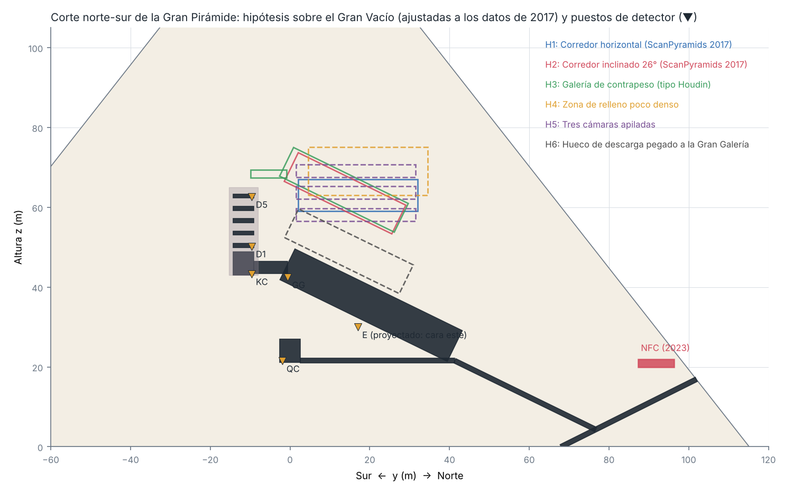
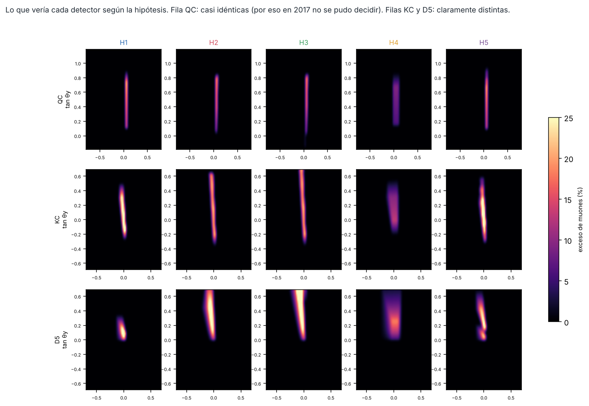
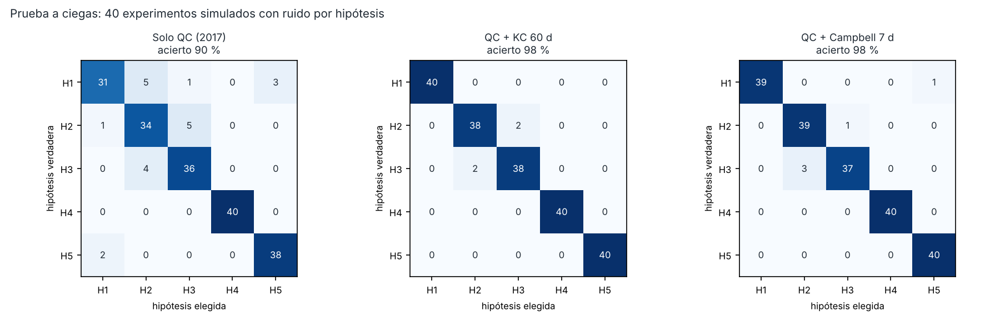

# Proyecto Pirámides

**¿Cómo se construyó la Gran Pirámide y qué es el Gran Vacío que hay dentro?** Una investigación abierta que va de la historia documentada a la física cuantitativa, con código reproducible y predicciones que se pueden comprobar.

Estado de la evidencia: octubre de 2026.



## Resultados principales

### 1. Una sola rampa con esquinas va justa; los sistemas en paralelo dejan margen → [docs/07](docs/07-resultados-construccion.md) y [docs/12](docs/12-la-fisica-de-la-esquina.md)
Simulamos hilada a hilada 10 métodos de elevación en cientos de escenarios con parámetros inciertos. El tiempo que un trineo cargado tarda en girar cada esquina sale de la física (doc. 12):
- **Una sola rampa con esquinas** (zigzag, espiral o la rampa interna de Houdin): mediana de **20–23 años**. Acaba dentro del reinado de Keops (~27 años) en el **74–85 %** de los escenarios, pero en ≤ 20 años solo en el 29–49 %. Es posible, pero ocuparía casi todo el reinado.
- **Sistemas en paralelo** (varias rampas, rampa recta y luego zigzag, o rampa recta y luego palancas): viables en el **100 %** de los escenarios en ≤ 27 años (96–100 % en ≤ 20 años), con ~5000 personas.
- El tiempo de giro es una **estimación** (el pivote dura segundos; el resto es una suposición sobre parar y arrancar): hay que **medirlo**.
- **Rampa recta hasta la cima**: necesitaría más volumen que la propia pirámide.
- **La mano de obra no era el problema; el flujo, sí.**
- ⚠️ **Corrección**: una versión anterior afirmaba que una sola rampa con esquinas era imposible (0 %). Esa conclusión venía de suponer giros de 2–15 min. La física da 0,3–2,8 min, y la retiramos.

### 2. Las vigas de granito no obligan a nada → [docs/08 §3](docs/08-gran-vacio-y-experimento-decisivo.md)
Para subir las ~43 vigas de 25–80 t de la Cámara del Rey hay tres métodos físicamente viables: rampa, contrapeso y palancas. La idea de que el Gran Vacío fuera una galería de contrapeso es **coherente** (el volumen alcanza para vigas de 60 t), pero **no necesaria**.

### 3. El Gran Vacío: qué se puede saber y cómo → [docs/08](docs/08-gran-vacio-y-experimento-decisivo.md)
- Nuestro modelo de muones reproduce los datos de ScanPyramids: tasas, excesos del 5–11 % y significaciones correctas hasta un factor ~2.
- **Con los detectores de 2017 era casi imposible distinguir** si el Vacío es horizontal, inclinado, una galería de contrapeso o varias cámaras. Eso explica por qué sigue sin resolverse.
- **Descartado**: un simple hueco de descarga pegado a la Gran Galería (29σ) y la rampa interna abierta de Houdin (17–32σ).
- **El experimento decisivo**: un detector de 1 m² en la **Cámara del Rey**, accesible al público, lo resolvería en **≤ 2 meses**; en la **Cámara de Campbell** bastarían ~1–5 días. Damos la imagen que debería verse con cada hipótesis.



### 4. La prueba más dura: ajuste conjunto y prueba a ciegas → [docs/09](docs/09-robustez-y-prueba-a-ciegas.md)
Cada hipótesis rival puede moverse ±3 m y cambiar su sección ×0,75–1,25 para imitar los datos. Los errores sistemáticos de flujo, densidad y geometría se ajustan libremente. Con esas reglas, en experimentos simulados a ciegas:
- **Solo con los datos de 2017**: el análisis acierta a menudo, pero con un margen de ~2σ. Insuficiente.
- **Con 60 días en la Cámara del Rey**: acierta el **96–98,5 %** con física realista alterada (flujo ±10 %, caliza de 2,35, cámaras desplazadas 1 m), con márgenes de ~4,3–5,6σ.
- **Advertencia**: la conclusión más espectacular, la galería de contrapeso, es la más sensible a errores de flujo. Las condiciones para afirmarla están en la predicción P7.



### 5. Qué cambiaría la historia → [docs/10](docs/10-que-cambiaria-la-historia.md)
Si el Vacío resultara ser una **galería de contrapeso**, sería la prueba más antigua conocida de elevación con contrapesos a gran escala. Se adelantaría unos 350 años al primer cigoñal conocido (Mesopotamia, ~2200 a. C.) y unos 1000 años a su llegada a Egipto (~1550 a. C.). Cualquier otro resultado también cerraría una pregunta abierta desde 2017.

### 6. Reanálisis independiente de los datos publicados en 2017 → [docs/11](docs/11-reanalisis-datos-2017.md)
Extrajimos de la figura del artículo los **679 puntos reales de KEK** y los perfiles de las **emulsiones de Nagoya**, y ajustamos el Vacío con nuestro propio modelo:
- **Validación**: nuestra geometría recupera las posiciones de los detectores publicadas (+5,7/−4,3 m frente a +5,8/−4,5 m).
- **Lo robusto**: el Vacío está cerca del eje de la Gran Galería (las emulsiones lo sitúan a +0,2 m y KEK a ~1,7 m al este), a ~47–63 m de altura, con una sección de ~8–21 m² según el conjunto de datos, comparable a la de la Galería.
- **La inclinación no se puede fijar** con los datos públicos:
  - las emulsiones prefieren horizontal o poco inclinado;
  - KEK prefiere inclinado;
  - bajo un mismo corredor, recto o compuesto, los dos conjuntos son incompatibles (Δχ² ≈ 78). Ninguna forma lo arregla, así que es un sistemático y no la geometría.
- **Un error nuestro, contado**: una primera versión daba "18° a 4–6σ" por un fallo de extracción, y lo detectamos y corregimos.

Conclusión: las figuras publicadas no deciden la forma del Vacío. La cota de Cramér–Rao ([docs/13](docs/13-limite-de-informacion.md)) indica que los **datos completos de 2017, analizados en estéreo**, darían un indicio de ~3σ. Hace falta medir desde la Cámara del Rey para llegar a 4–9σ.

### 7. Los canales de la Gran Pirámide → [docs/14](docs/14-canales-estrellas-o-proporciones.md)
Recalculamos con precisión (catálogo de Yale, precesión IAU 2006) a qué estrellas apuntaban los cuatro canales:
- **Los dos canales del Rey dan fechas en tensión**: Alnitak 2497 ± 41 a. C. y Thuban 2338 ± 53 a. C. (2,4σ).
- **La alineación con cuatro estrellas no es especial**: con estrellas de V ≤ 3,0, los ángulos reales no la producen, y el 27 % de los ángulos al azar sí.
- **Las pendientes n/11** (7/11, 9/11, 11/11) encajan, pero con la corrección justa p = 16 %: **no es significativo**.
- **Medición que lo decide**: el tramo alto del canal norte de la Cámara de la Reina (P10).

### 8. La orientación al norte → [docs/15](docs/15-orientacion-al-norte.md) (v2, revisada)
Con los datos de la tabla de Spence (2000) y solo estrellas visibles:
- **La deriva es real**.
- **Sin el "cambio de configuración" de Kefrén, nada encaja**.
- **Con ese cambio**, Kochab + Mizar es el mejor par con fechas históricamente plausibles y reproduce la fecha de Spence (Keops hacia el 2478 a. C.). Pero una recta genérica ajusta igual, y **la fecha de Spence choca con el radiocarbono**: la datación astronómica no se sostiene.
- **Unas no encaja**: el método habría cambiado en la V dinastía.
- *Una versión anterior, con fechas erróneas y estrellas bajo el horizonte, decía lo contrario. La hemos corregido.*

### 9. De Giza a la Luna → [docs/16](docs/16-de-giza-a-la-luna.md)
- **La energía**: construir la Gran Pirámide costó unos **2,5 GWh** de trabajo mecánico, lo que produce una central de 100 MW en ~25 horas. El **77 % se fue en rozamiento**.
- **El cuello de botella**: el problema nunca fue la energía, sino el rozamiento, el flujo y la organización.
- **La lección para la Luna**: núcleo basto y revestimiento fino, menos rozamiento antes que más potencia, y vías en paralelo.

### 10. Predicciones registradas → [PREDICCIONES.md](PREDICCIONES.md)
Siete predicciones concretas, fechadas en git **antes** de que existan las mediciones que las comprobarán. Incluyen la huella de las rampas en las aristas medible desde fuera (P6) y las condiciones para afirmar la galería de contrapeso (P7).

## La parte histórica
| Archivo | Contenido |
|---|---|
| [01 — Tecnología documentada](docs/01-tecnologia-documentada.md) | Canteras, herramientas, transporte, precisión y mano de obra |
| [02 — ¿Por qué "se perdió"?](docs/02-por-que-se-perdio.md) | No se perdió: se abandonó |
| [03 — Misterios abiertos](docs/03-misterios-abiertos.md) | Lo que de verdad no sabemos (2017–2026) |
| [04 — Teorías alternativas](docs/04-teorias-alternativas.md) | Extraterrestres, Atlántida, geopolímero... evaluadas una a una |
| [05 — Plan de investigación](docs/05-plan-de-investigacion.md) | Líneas de trabajo |
| [06 — Método y validación](docs/06-metodo-y-validacion.md) | Cómo funciona el simulador y contra qué se ha validado |
| [07 — Resultados de construcción](docs/07-resultados-construccion.md) | Qué métodos de elevación son viables |
| [08 — Gran Vacío y experimento decisivo](docs/08-gran-vacio-y-experimento-decisivo.md) | Hipótesis, vigas de granito, diseño de la medición |
| [09 — Robustez y prueba a ciegas](docs/09-robustez-y-prueba-a-ciegas.md) | Ajuste conjunto, sistemáticos y física alterada |
| [10 — Qué cambiaría la historia](docs/10-que-cambiaria-la-historia.md) | Qué significaría cada resultado y hoja de ruta |
| [11 — Reanálisis de los datos de 2017](docs/11-reanalisis-datos-2017.md) | Datos reales de KEK y Nagoya ajustados con nuestro modelo |
| [12 — La física de la esquina](docs/12-la-fisica-de-la-esquina.md) | Corrección de una conclusión y protocolo del experimento del trineo |
| [13 — El límite de la información](docs/13-limite-de-informacion.md) | Cota de Cramér–Rao: qué pueden decir como máximo los datos de 2017 y la Cámara del Rey |
| [14 — Los canales: ¿estrellas o proporciones?](docs/14-canales-estrellas-o-proporciones.md) | Astronomía de precisión y prueba contra el azar de la hipótesis estelar; patrón de pendientes n/11 |
| [15 — ¿Cómo encontraron el norte?](docs/15-orientacion-al-norte.md) | 92 pares de estrellas contra las orientaciones medidas: la deriva es real, pero no sirve para fechar |
| [16 — De Giza a la Luna](docs/16-de-giza-a-la-luna.md) | La Gran Pirámide costó ~2,5 GWh de trabajo mecánico (25 h de una central de 100 MW); lecciones para construir en la Luna |
| [ARTICULO.md](ARTICULO.md) | Borrador del artículo (en español) |
| [preprint/preprint_en.pdf](preprint/preprint_en.pdf) | **Preprint en inglés** con todos los resultados, con fuente LaTeX para arXiv |
| [PROPUESTA_SCANPYRAMIDS_en.md](PROPUESTA_SCANPYRAMIDS_en.md) | Propuesta técnica en inglés para los equipos de muografía: la medición desde la Cámara del Rey |
| [PLAN_DE_CONTACTO.md](PLAN_DE_CONTACTO.md) | Qué grupo puede comprobar cada predicción y en qué orden escribirles |
| [PROPUESTA_EXPERIMENTO_TRINEO.md](PROPUESTA_EXPERIMENTO_TRINEO.md) | Propuesta para museos y universidades: medir cuánto tarda un trineo de 2,5 t en girar una esquina |
| [FUENTES](docs/FUENTES.md) | Bibliografía |

## Reproducir
```bash
pip install -r requirements.txt
python -m pytest -q tests                      # 29 pruebas
cd simulador && python ejecutar_todo.py        # ~5 min: resultados 01-04 y figuras
python ejecutar_profundo.py                    # ~12 min: robustez, prueba a ciegas, aristas
# Reanálisis de los datos publicados (requiere el PDF de arXiv:1711.01576):
python extraer_datos_kek.py 1711.01576.pdf && python extraer_datos_emulsiones.py 1711.01576.pdf
PYTHONPATH=. python reanalisis_emulsiones_inclinacion.py   # y reanalisis_kek_inclinacion.py, reanalisis_conjunto.py
PYTHONPATH=. python estudio_giros.py                      # física del giro (~3 min)
```

Estructura:
- `simulador/piramide/`:
  - `geometria.py`: forma de la pirámide y estructuras internas;
  - `muones.py`: modelo de muografía;
  - `fisica.py`, `rampas.py`, `obra.py`, `montecarlo.py`: construcción;
  - `granito.py`: vigas de la Cámara del Rey;
  - `vacio.py`: hipótesis sobre el Gran Vacío y diseño de la medición;
  - `robustez.py`: ajuste conjunto, sistemáticos perfilados y prueba a ciegas;
  - `aristas_muones.py`: huella de las rampas integradas en las aristas;
  - `reanalisis.py`, `reanalisis_emulsiones.py`: modelo directo de los detectores de KEK y Nagoya para ajustar sus datos publicados.
- `datos/piramide_keops.json`: cada valor con su fuente.

## Honestidad
- **No afirmamos haber descubierto qué es el Gran Vacío.** Mostramos por qué no se ha podido saber y **qué medición concreta lo resolvería**, con las predicciones escritas de antemano.
- Los modelos son simplificados: posiciones internas con ±1–2 m de error, sin simulación completa con Geant4 y un modelo de flujo medio. Todas las limitaciones están en [docs/06](docs/06-metodo-y-validacion.md).
- Las ideas de partida no son nuestras: vienen de Houdin, Lehner, Rosell Roig y ScanPyramids. Lo que aportamos es el **marco cuantitativo y abierto** que las pone a prueba juntas.
