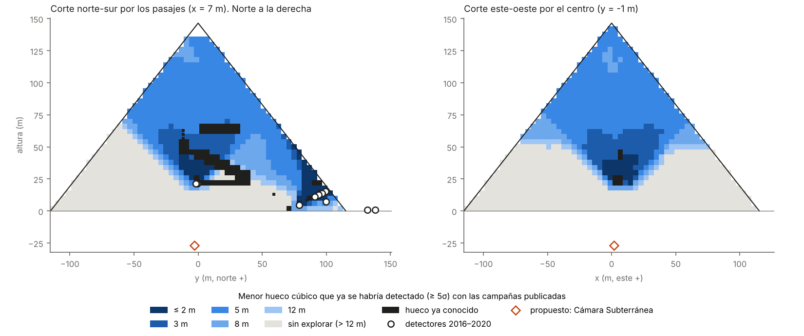
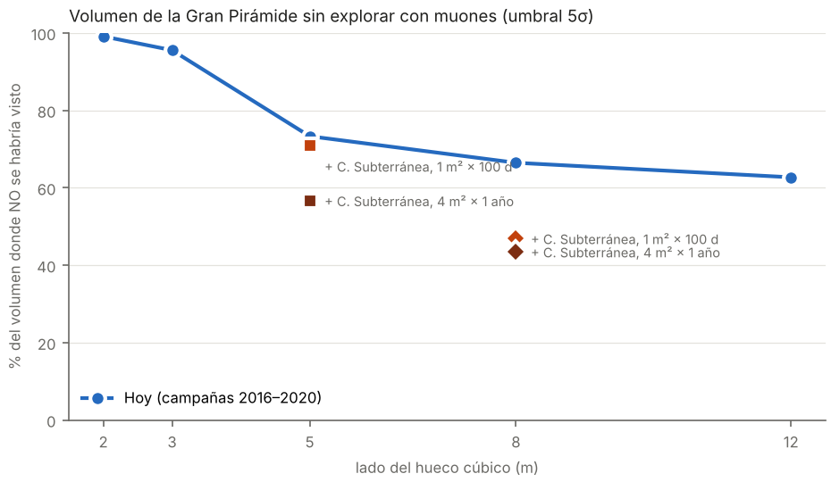

# 17 — ¿Cuánto de la Gran Pirámide se ha explorado de verdad? Mapa de exclusión muográfico

> **Resumen.** Desde 2015, la muografía encontró dos huecos en la Gran Pirámide: el Gran Vacío y el corredor de la cara norte (NFC). La pregunta inversa nunca se había contestado de forma cuantitativa, que sepamos: **¿en qué partes de la pirámide se puede afirmar que NO hay otro hueco, y de qué tamaño?** Es lo que en física de partículas se llama un *mapa de exclusión*.
>
> Modelamos las 14 campañas publicadas (2016–2020), con las posiciones, áreas y días de los artículos, y las calibramos para que reproduzcan las significaciones publicadas. El resultado:
> - **En el 66 % del volumen podría haber un hueco cúbico de 8 m (512 m³, más que la Cámara del Rey) sin que ningún detector lo hubiera visto.** Para 5 m, el 73 %; para 3 m, el 96 %.
> - **El 85 % de ese volumen sin explorar está por debajo de 40 m de altura.** Es geometría pura: los detectores interiores están a 21 m o más y solo miran hacia arriba, y los exteriores miran a la Galería. Entre 0 y 20 m, el 99 % del volumen **no ha estado nunca en el campo de visión** de ningún detector.
> - **Un solo detector en la Cámara Subterránea**, excavada en la roca 30 m bajo la base, cambiaría esto. Con 1 m² de emulsión durante 100 días, el volumen explorado para huecos de 8 m pasaría del **34 % al 61 %**. Ningún otro puesto accesible se le acerca: la Cámara del Rey o la de Campbell no añaden casi nada, porque miran a zonas ya cubiertas.
>
> No hemos encontrado ninguna medición de muones publicada desde la Cámara Subterránea de Keops. El precedente es de L. Alvarez (1970), que midió la pirámide de Kefrén con detectores en la Cámara de Belzoni, en su base, mirando hacia arriba. Según la crónica de APS News, en 1969 informó de que había explorado ~19 % de la pirámide sin encontrar cámaras: también él publicó, de hecho, un mapa de lo explorado.

Archivos:
- código: [`simulador/piramide/cobertura.py`](../simulador/piramide/cobertura.py), [`simulador/estudio_cobertura.py`](../simulador/estudio_cobertura.py), [`simulador/estudio_cobertura_robustez.py`](../simulador/estudio_cobertura_robustez.py), [`simulador/figuras_cobertura.py`](../simulador/figuras_cobertura.py);
- resultados: [`resultados/19_cobertura.json`](../resultados/19_cobertura.json) (y `.npz` con el mapa completo), [`resultados/20_cobertura_robustez.json`](../resultados/20_cobertura_robustez.json);
- figuras: `figuras/08a_mapa_exclusion_cortes.png`, `figuras/08b_volumen_sin_explorar.png`.

## 1. Por qué esta pregunta importa
Un resultado negativo bien medido vale tanto como un descubrimiento. Decir "no hay más cámaras" sin decir **dónde se ha mirado y con qué sensibilidad** no es ciencia. Y, al revés, saber dónde no se ha mirado dice exactamente dónde medir a continuación. Es la lógica con la que la física de partículas busca nuevas partículas: primero se dibuja lo que ya está excluido.

## 2. Método
1. **Rejilla**: el interior de la pirámide original, en celdas de 4 m (40 387 puntos libres de estructuras conocidas, 2,58 millones de m³).
2. **Hipótesis**: en cada punto, un cubo de aire de lado s = 2, 3, 5, 8 o 12 m.
3. **Señal**: para cada campaña, el modelo de muones del proyecto (docs/06) calcula el cambio de cuentas en cada bin angular (0,02 en tanθ), con 2 % de sistemático por bin y resolución de ~20 mrad. Cada bin se traza con hasta 6 × 6 subrayos, para no saltarse huecos más estrechos que un bin. **Este fallo existía en la primera versión del cálculo y lo corregimos**: a 125 m de distancia, un bin mide 2,5 m, y el Gran Vacío, con 1,6 m de ancho, quedaba entre dos rayos.
4. **Referencia**: las estructuras conocidas, más el NFC y el Gran Vacío. La pregunta es si habría **otro** hueco.
5. **Calibración**: la significación del modelo se multiplica por un factor por familia de detector, para que reproduzca lo publicado sobre el Gran Vacío:
   - emulsiones de Nagoya (13,7σ en NE1, 12,7σ en NE2): **×0,44** (el modelo es optimista dentro de la pirámide, como ya se vio en docs/06);
   - telescopios de CEA (5,8σ combinado): **×2,6** (el modelo es pesimista desde fuera).
   
   Los hodoscopios de KEK y las emulsiones de 2019 usan el factor de Nagoya; los telescopios de CEA de 2019 usan el de CEA.
6. **Criterio**: un hueco está **excluido** si la combinación de todas las campañas (suma en cuadratura) da **≥ 5σ** (nominal) o **≥ 3σ** (optimista).

### Validación
| Comprobación | Modelo | Publicado |
|---|---|---|
| Gran Vacío, CEA G1 y G2 por separado | 4,3σ y 3,7σ | 5,2σ y 3,6σ |
| Gran Vacío, KEK H1 y H2 | 21σ y 21σ | "> 10σ" en casi todos los cortes |
| NFC desde las emulsiones del corredor descendente (2019) | 40–84σ | "muy por encima de 10σ" |
| NFC desde los telescopios exteriores de 2017 | ~2,7σ | no se informó en 2017 (coherente) |

### Campañas modeladas
| Campaña | Lugar | Área | Días | Fuente |
|---|---|---|---|---|
| Nagoya NE1, NE2 | Cámara de la Reina (nicho este; esquina suroeste) | 0,45 m² | 98; 140 | Morishima et al., *Nature* 2017 |
| KEK H1, H2 | Cámara de la Reina | 1,44 m² (dos planos a 1,5 m y 1,0 m) | ~150; ~240 | ídem |
| CEA G1, G2 | Exterior, a 17 y 23 m de la cara norte | 0,25 m² | 60 | ídem |
| Nagoya EM1–EM4 | Corredor descendente | 0,225 m² por unidad | 79–211 | Procureur et al., *Nat. Commun.* 2023 |
| Nagoya EM5–EM7 | Túnel de al-Mamún | 4 × 0,075 m² | 272 | ídem |
| CEA Joliot, Degennes, Charpak | Corredor descendente y cruce con el ascendente | 0,25–1 m² | 140–158 | ídem |

## 3. Resultados
### Volumen sin explorar (fracción del volumen libre donde un cubo de ese lado NO se habría detectado)
| Lado del cubo | 2 m | 3 m | 5 m | 8 m | 12 m |
|---|---|---|---|---|---|
| Nominal (≥ 5σ) | 99 % | 96 % | **73 %** | **66 %** | 63 % |
| Optimista (≥ 3σ) | 98 % | 88 % | 69 % | 65 % | 62 % |

La fracción apenas baja de 8 m a 12 m. Lo que queda sin explorar no es una cuestión de sensibilidad, sino de **geometría**: esa parte de la pirámide no ha estado nunca delante de un detector.

### Por alturas (cubo de 5 m, nominal)
| Altura | 0–20 m | 20–40 m | 40–60 m | 60–80 m | > 80 m |
|---|---|---|---|---|---|
| Sin explorar | 99 % | 91 % | 67 % | 21 % | 3 % |
| Peso en el volumen total | 36 % | 26 % | 18 % | 11 % | 9 % |

**Comprobación sin modelo de muones.** Solo con la geometría (dirección dentro de la aceptancia del detector y a menos de 70° del cenit), el **67 %** del volumen queda fuera del campo de visión de todas las campañas, y el 99 % de los 20 m inferiores. El hallazgo principal no depende de la calibración.

### Dónde medir después (1 m² de emulsión, 100 días, en cada puesto)
| Puesto | Volumen nuevo explorado, huecos de 8 m | Huecos de 5 m |
|---|---|---|
| **Cámara Subterránea** | **+28 %** (34 % → 61 %) | +3 % |
| Cámara Subterránea, 4 m² durante 1 año | +34 % (→ 67 %) | **+26 %** (27 % → 52 %) |
| Exterior oeste / sur / este (a 15 m de la base) | +6 % / +7 % / +5 % | +2 % |
| Cámara del Rey, Cámara de Campbell, cabeza de la Gran Galería | ~0 % | ~0 % |

Lo que la Cámara Subterránea añade está entre 6 y 58 m de altura, en un radio de ~80 m alrededor del eje: es justo el núcleo de la mitad inferior. Los puestos altos, que eran los mejores para decidir la forma del Gran Vacío (docs/08), no sirven para buscar huecos nuevos, porque miran a la parte que ya está cubierta.

## 4. Robustez
Ver [`resultados/20_cobertura_robustez.json`](../resultados/20_cobertura_robustez.json), calculado con una rejilla de 8 m:

Cada celda da el % del volumen sin explorar con el criterio nominal (≥ 5σ) / optimista (≥ 3σ).

| Variante | Cubo de 8 m | Cubo de 5 m |
|---|---|---|
| Nominal (rejilla de 8 m) | 66 / 65 | 73 / 69 |
| Sin calibrar (factor 0,5 para todas las familias) | 68 / 66 | 76 / 72 |
| Sistemático del 1 % por bin | 66 / 65 | 73 / 69 |
| Sistemático del 3 % por bin | 66 / 65 | 73 / 69 |
| Detectores desplazados al azar (σ = 2 m en horizontal, 1 m en vertical), 5 sorteos | 65–66 / 64–65 | 72–74 / 69–70 |

**El resultado no depende de los detalles.** Ni la calibración, ni el sistemático, ni la posición exacta de los detectores mueven la fracción más de 3 puntos. Lo que deja la base sin explorar es dónde estuvieron los detectores, no la sensibilidad del modelo.

## 5. Límites (lo que este mapa NO dice)
- **No dice que haya cámaras ocultas.** Dice dónde no se puede descartar que las haya. La mayor parte de la pirámide es, casi con seguridad, mampostería maciza: la ausencia de pruebas no es prueba de nada en ningún sentido.
- **El modelo es simplificado**: no hay Geant4, la geometría interna tiene ±1–2 m de error y el sistemático del 2 % es independiente bin a bin. Las posiciones de las campañas de 2019 son aproximadas (±2–3 m), porque los artículos no dan coordenadas.
- **Las suposiciones son optimistas** para los detectores publicados: área efectiva plana para los telescopios, suma en cuadratura de todas las campañas como si se hubieran analizado juntas, y ninguna confusión con estructuras vecinas. El volumen sin explorar real es, por tanto, **igual o mayor** que el calculado.
- **Puede haber datos no publicados.** ScanPyramids puede tener mediciones que no conocemos. El mapa se refiere a lo publicado.
- **La Cámara Subterránea tiene sus propios sistemáticos.** La roca madre puede no ser homogénea (fisuras, el "pozo" y el pasaje ciego del sur, el pozo de servicio y la "gruta"). Con la densidad de la roca tomada en 2,3 t/m³ y el 2 % por bin, la sensibilidad podría ser optimista. A favor: las estructuras conocidas que quedan encima servirían de calibración en el propio mapa. El modelo predice el bloque de granito de la Cámara del Rey como déficit de muones a ~23σ, la Gran Galería a ~7σ y la Cámara de la Reina a ~4σ (P12). El corredor descendente y el NFC quedan fuera de su campo de visión.
- **Huecos de otras formas.** Un corredor de 1–2 m de sección y mucha longitud se ve mejor o peor que un cubo según su orientación. El NFC, por ejemplo, se vio a > 10σ con una sección de 2 × 2 m porque se miró a lo largo.

## 6. Qué haría falta
1. **Una campaña de emulsiones en la Cámara Subterránea**, del orden de 1–4 m² durante 3–12 meses. Es el mismo tipo de detector que Nagoya ya instaló en el corredor descendente, que es el acceso a esa cámara. Es la medición con mayor rendimiento científico por coste que hemos encontrado.
2. **Los mapas originales de todas las campañas**, para sustituir este modelo por los datos.
3. A más largo plazo, **los telescopios exteriores de gran área** del proyecto EGP (Bross et al. 2022) cubrirían la periferia inferior, que ni siquiera la Cámara Subterránea ve.

## Referencias
- Morishima, K. et al. (2017). *Discovery of a big void in Khufu's Pyramid by observation of cosmic-ray muons*. Nature 552, 386–390 (arXiv:1711.01576), Methods.
- Procureur, S., Morishima, K. et al. (2023). *Precise characterization of a corridor-shaped structure in Khufu's Pyramid by observation of cosmic-ray muons*. Nat. Commun. 14, 1144.
- Alvarez, L. W. et al. (1970). *Search for hidden chambers in the pyramids*. Science 167, 832–839.
- APS News (2019). *This month in physics history: Alvarez and the pyramids* (cifra del ~19 %).
- Bross, A. et al. (2022). *Tomographic muon imaging of the Great Pyramid of Giza*. arXiv:2202.08184.
