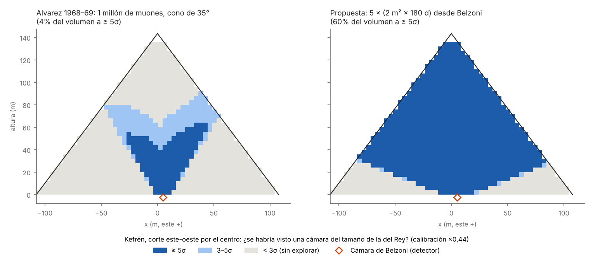

# 18 — Kefrén: el experimento inacabado de Alvarez

> **Resumen.** En 1968–69, Luis Alvarez (premio Nobel de Física en 1968) puso detectores de muones en la Cámara de Belzoni, bajo el centro de la pirámide de Kefrén. Concluyó que no había cámaras del tamaño de la del Rey dentro de un cono de 35° alrededor de la vertical, que es "el 19 % del volumen de la pirámide". Escribió que esperaba "reorganizar el equipo para mirar a través del 81 % restante". No hemos encontrado que ese segundo experimento se publicara nunca.
>
> Reconstruimos su experimento con el modelo de muones del proyecto y obtenemos tres resultados:
> 1. **El modelo reproduce a Alvarez.** Su cono contiene el 20,4 % del volumen (él dio 19 %). Con el modelo sin calibrar y su millón de muones, una cámara del tamaño de la del Rey se detectaría en el 80 % del cono a ≥ 5σ y en el 97,5 % a ≥ 3σ, que es lo que él afirmó. Es una **validación independiente** del método que usamos en Keops (docs/17), con un experimento distinto, de otra época y en otra pirámide.
> 2. **Kefrén está menos explorada de lo que se cree.** El 19 % es un techo. Con criterio de 5σ, lo explorado de verdad para cámaras del tamaño de la del Rey está entre el **4 % y el 18 %** del volumen, según la calibración. Para huecos de 5 m, menos del 6 %.
> 3. **El experimento se puede terminar desde el mismo sitio.** Cinco exposiciones de emulsión moderna en la Cámara de Belzoni (2 m² × 180 días cada una: una cenital y cuatro inclinadas 45° hacia cada cara) cubrirían el **~61 %** de la pirámide para cámaras del tamaño de la del Rey. Quedarían sin explorar sobre todo los 20 m inferiores, como en Keops.

Archivos:
- código: [`simulador/piramide/kefren.py`](../simulador/piramide/kefren.py), [`simulador/estudio_kefren.py`](../simulador/estudio_kefren.py), [`simulador/figuras_kefren.py`](../simulador/figuras_kefren.py);
- resultados: [`resultados/21_kefren.json`](../resultados/21_kefren.json);
- figura: `figuras/09_kefren_alvarez.png`.

## 1. El experimento de 1968–69 (Alvarez et al., *Science* 167, 832–839, 1970)
- **Detector**: dos pares de cámaras de chispas de 1,8 × 1,8 m (≈ 4 m²), separadas 0,3 m, con contadores de centelleo y 1,2 m de hierro, en la esquina sureste de la Cámara de Belzoni, "justo debajo de la base de la pirámide, cerca de su centro".
- **Datos**: "más de un millón" de muones en varios meses, en bins de 3° × 3°, hasta ~45° del cenit.
- **Método**: comparar con una pirámide simulada de densidad uniforme. Las cuatro aristas y el remate de caliza original se ven con claridad.
- **Conclusión**: "no tenemos duda de que detectaríamos una Cámara del Rey en cualquier punto por encima de la Cámara de Belzoni dentro de un cono de 35°". Ese cono es "el 19 % del volumen de la pirámide".

## 2. Reconstrucción
- **Geometría de Kefrén**: lado original 215,25 m (410 codos) y altura original 143,5 m. Hoy mide 136,4 m: el vértice está truncado.
- **Detector**: a ras de la base, en (5, −1,5) m.
- **Modelo de flujo**: el mismo que en Keops (docs/06), con caliza de 2,2 t/m³.
- **Exposición**: se ajusta para que el análisis, restringido al cono de 35°, contenga **10⁶ muones**.
- **Hueco buscado**: del tamaño de la Cámara del Rey (10,47 × 5,23 × 5,84 m), y también cubos de 8 m y 5 m.
- **Calibración**: se dan dos versiones. Sin calibrar (×1) y con el factor ×0,44 que reproduce las significaciones publicadas por Nagoya en Keops (docs/17).

### Validación
| Magnitud | Modelo | Alvarez 1970 |
|---|---|---|
| Volumen dentro del cono de 35° | 20,4 % | 19 % |
| Cámara del Rey detectable dentro del cono (sin calibrar) | 80 % a ≥ 5σ; 97,5 % a ≥ 3σ | "en cualquier punto del cono" |
| Cámara del Rey a 40 m sobre Belzoni (su figura 11) | 11,9σ | señal "evidente" |

El modelo sin calibrar coincide con lo que Alvarez afirmó. Con la calibración de Nagoya, más conservadora, su afirmación solo se cumpliría a 3σ en la mitad del cono (54 %). La diferencia muestra cuánto depende la cobertura del criterio estadístico. Por eso damos siempre las dos versiones.

## 3. ¿Cuánto de Kefrén está explorado?
| Hueco | Explorado a ≥ 5σ (calibrado / sin calibrar) | A ≥ 3σ |
|---|---|---|
| Del tamaño de la Cámara del Rey | **4 % / 18 %** | 12 % / 22 % |
| Cubo de 8 m | 11 % / 22 % | 20 % / 23 % |
| Cubo de 5 m | 1 % / 6 % | 3 % / 14 % |

**Más del 80 % de la segunda pirámide de Giza no se ha examinado nunca con muones**, con ningún criterio, según lo publicado. Es la misma cifra que dio el propio Alvarez hace 56 años.

## 4. Cómo terminar el experimento
Desde la misma Cámara de Belzoni, con emulsiones modernas analizadas con |tanθ| ≤ 1:

| Configuración | Cámara tipo Rey a ≥ 5σ (calibrado / sin calibrar) | Cubo de 8 m | Cubo de 5 m |
|---|---|---|---|
| Una exposición cenital, 2 m² × 180 días | 32 % / 36 % | 35 % / 37 % | 18 % / 32 % |
| **Cinco exposiciones (cenital + 4 inclinadas 45°), 2 m² × 180 días cada una** | **61 % / 62 %** | 62 % / 63 % | 46 % / 60 % |

Tras la propuesta, lo que sigue sin explorar para cámaras del tamaño de la del Rey son los **20 m inferiores (88 %)** y, en parte, de 20 a 40 m (28 %). Para esa franja harían falta puestos en los pasajes bajos o fuera de la pirámide, como en Keops.

Las cinco orientaciones se pueden exponer a la vez si hay película suficiente: Nagoya llegó a tener 8 m² instalados en Keops. Con 10 m² en total, todo el experimento cabe en **unos seis meses**.

## 5. Límites
- **Modelo simplificado**: sin Geant4 y con densidad uniforme. No incluye las irregularidades del núcleo de roca natural, que en Kefrén es importante: la esquina noroeste está tallada en la roca y la sureste está construida sobre una plataforma. Para un análisis real, esas heterogeneidades serían el principal sistemático, como ya lo fue para Alvarez.
- **Posición del detector**: se toma la esquina sureste de la cámara a ras de la base. Desplazarla unos metros cambia poco la cobertura de un cono tan ancho.
- **Exposición de 1969**: no se modela su eficiencia real. Se ajusta el número de muones (10⁶), que es lo que fija la estadística.
- **Datos no publicados**: puede haberlos. El mapa se refiere a lo publicado.
- **No dice que haya cámaras en Kefrén.** Dice que la mayor parte de la pirámide no se ha examinado, y cómo examinarla.

## Referencias
- Alvarez, L. W. et al. (1970). *Search for hidden chambers in the pyramids*. Science 167, 832–839.
- Morishima, K. et al. (2017). Nature 552, 386–390 (calibración de Nagoya; docs/17).
