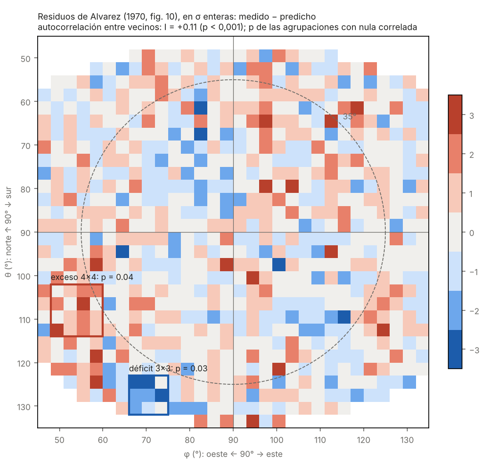

# 19 — Los datos de Alvarez, 56 años después

> **Resumen.** Alvarez et al. (*Science*, 1970) publicaron, además de su conclusión, el mapa de diferencias entre los muones medidos y los predichos por su mejor modelo: una matriz de 30 × 30 casillas de 3° × 3° (su figura 10). Su ajuste daba **χ² = 905 para unas 750 casillas efectivas**, unas 4 desviaciones por encima de lo esperable si solo hubiera ruido. No hemos encontrado ningún reanálisis publicado de ese mapa.
>
> Lo hemos transcrito (801 casillas) y analizado con pruebas de permutaciones y con una hipótesis nula que conserva la correlación espacial. Resultados:
> 1. **Los residuos tienen estructura espacial clara.** La correlación entre casillas vecinas es I de Moran = +0,11, con p < 0,0005: ninguna de 2 000 permutaciones la iguala. El exceso de χ² de Alvarez no es ruido repartido al azar, sino errores sistemáticos con correlación espacial. Es un dato nuevo sobre su experimento.
> 2. **No hay ninguna agrupación significativa que indique una cámara oculta.** Las dos más extremas son un exceso de muones hacia el oeste-suroeste, a ~38° del cenit, con p = 0,04, y un déficit hacia el sur-suroeste, en el borde del campo, con p = 0,03. Esos valores son ya globales y tienen en cuenta la correlación espacial, pero no que se han probado 6 estadísticos: contando eso, ninguna pasa de ~2σ.
> 3. **La pista de Gutowski et al. (2017)** (un exceso entre 62° y 72° de acimut) **no aparece** en el mapa de residuos de Alvarez, con ninguna de las cuatro lecturas posibles del acimut.
>
> Es un resultado negativo, pero informativo: los datos de 1969 no esconden una cámara que Alvarez pasara por alto, y su principal limitación eran los errores sistemáticos con estructura, no la estadística. Por eso una medición nueva (P13) debería modelar la geometría y el instrumento mucho mejor de lo que se pudo en 1969.

Archivos:
- datos: [`datos/alvarez_1970/fig10_residuos.txt`](../datos/alvarez_1970/fig10_residuos.txt);
- código: [`simulador/reanalisis_alvarez.py`](../simulador/reanalisis_alvarez.py), [`simulador/figuras_alvarez.py`](../simulador/figuras_alvarez.py);
- resultados: [`resultados/23_reanalisis_alvarez.json`](../resultados/23_reanalisis_alvarez.json);
- figura: `figuras/10_residuos_alvarez.png`.

## 1. Los datos
En la página 836 del artículo, Alvarez publicó tres matrices de 30 × 30 casillas:
- **figura 8**: muones medidos;
- **figura 9**: muones predichos por el mejor ajuste;
- **figura 10**: diferencia entre ambas, en desviaciones estándar redondeadas a enteros.

El pie de la figura 10 da **χ² = 905**, y el texto dice que el número efectivo de casillas es "cercano a 750". En total, unos 650 000 muones pasaron la selección final.

**Transcripción.** Se hizo a partir de la imagen del artículo, ampliada a 420–900 ppp. El reconocimiento de caracteres del PDF no sirve: confunde el "1" con "3.".
- **Filas y columnas.** Salen 29 filas con valores; la primera fila de la matriz está vacía. Los valores de cada fila se alinean con el eje norte-sur dibujado, y las casillas vacías solo aparecen en los bordes. Queda una incertidumbre de ±1 fila (±3°) en la posición absoluta, que no afecta a las pruebas de agrupación.
- **Valores dudosos.** Tres tienen el signo dudoso; se analizan sus 8 combinaciones y ningún resultado cambia.
- **Comprobación con el χ².** Σr² = 1074 para 801 casillas. Si el χ² publicado (905) correspondiera a esas 801 casillas, con redondeo cabría esperar ~973. La diferencia del ~10 % puede deberse a las ~50 casillas de borde que aparecen en la figura pero quizá no entraron en el χ², o a errores de transcripción. Ninguna de las dos cosas crearía por sí sola la correlación espacial observada.

## 2. Método
- **I de Moran** entre vecinos (horizontal y vertical) para medir la correlación espacial.
- **Búsqueda de agrupaciones:** máximo de Σr/√n en todas las ventanas completas de 2 × 2, 3 × 3 y 4 × 4 casillas, tanto para excesos (más muones: un hueco) como para déficits (más materia).
- **Dos hipótesis nulas:**
  - permutaciones de los residuos entre las casillas válidas (2 000), que suponen independencia;
  - campos aleatorios gaussianos con la misma correlación espacial y la misma dispersión que los datos, redondeados a enteros (4 000). Esta es la exigente: una vez establecido que hay correlación, la primera exagera la significación de cualquier agrupación.
- **Valores p globales:** comparan el máximo observado con el máximo de cada simulación, es decir, ya incluyen el efecto de buscar en todo el mapa.

## 3. Resultados
| Estadístico | Valor | p (permutaciones) | p (nula correlada) | Dirección (θ, φ) |
|---|---|---|---|---|
| I de Moran | +0,11 | < 0,0005 | — | — |
| Exceso 2 × 2 | 4,0 | 0,44 | 0,74 | (63°, 96°) |
| Exceso 3 × 3 | 4,7 | 0,05 | 0,19 | (110°, 53°) |
| Exceso 4 × 4 | 5,3 | 0,005 | **0,04** | (108°, 54°) |
| Déficit 2 × 2 | 5,0 | 0,004 | 0,09 | (126°, 69°) |
| Déficit 3 × 3 | 5,3 | 0,001 | **0,03** | (128°, 71°) |
| Déficit 4 × 4 | 5,0 | 0,002 | 0,07 | (126°, 72°) |

θ crece de norte a sur y φ de oeste a este; (90°, 90°) es la vertical. El exceso 4 × 4 está a ~18° al sur y ~36° al oeste de la vertical: unos 38° del cenit, con acimut ~246°. Queda justo fuera del cono de 35° que Alvarez analizó. El déficit está en el borde sur-suroeste del campo.

**Zona de Gutowski et al.** Para una cámara a 30° del cenit y acimut 67°, se probaron cuatro lecturas de la convención del acimut. La suma normalizada en 3 × 3 casillas da +0,7, +1,0, −0,3 y +2,0: ninguna es destacable. Los estudiantes también mencionan un pico a 270° (oeste). Nuestro exceso más fuerte está a ~246°, pero ambos salen de los **mismos datos**, así que no son indicios independientes, y el nuestro no es significativo.

## 4. Qué significa
- **Para la pregunta "¿hay una cámara en Kefrén?"**: los residuos publicados no la muestran en el cono de 35°, ni en su borde. Concuerda con lo que dijo Alvarez.
- **Para la pregunta "¿cuánto se puede fiar uno del análisis de 1969?"**: menos de lo que su χ² sugiere. Los residuos tienen estructura, probablemente por la geometría exterior, las zonas muertas entre las cámaras de chispas que él mismo describe, la variación norte-sur de sensibilidad que tuvo que "inventar" y la roca bajo la pirámide. Una agrupación debida a un sistemático se parece a una cámara pequeña. Esto refuerza el análisis del documento 18: la cobertura real de Alvarez está más cerca del extremo pesimista.
- **Para el futuro (P13)**: una medición moderna desde la Cámara de Belzoni podrá comprobar, de paso, las dos direcciones señaladas aquí. El exceso a ~38° del cenit hacia el oeste-suroeste queda dentro del campo de la exposición inclinada hacia el oeste. No es una predicción de que haya algo, sino de dónde mirar con más cuidado.

## 5. Límites
- Los residuos están redondeados a σ enteras: se pierde resolución, sobre todo para señales de 1–2σ por casilla.
- La transcripción puede tener errores sueltos. Los valores dudosos se probaron con ambos signos.
- No disponemos de las cuentas de las figuras 8 y 9 transcritas; con ellas se podría rehacer el ajuste con un modelo moderno. Es el siguiente paso natural.
- La nula correlada supone un campo gaussiano estacionario. Si la estructura real es más irregular (por ejemplo, concentrada en los bordes), los valores p cambiarían algo.

## Referencias
- Alvarez, L. W. et al. (1970). *Search for hidden chambers in the pyramids*. Science 167, 832–839 (figuras 8–10, p. 836).
- Gutowski, B. et al. (2017). *The secret chambers in the Chephren Pyramid*. arXiv:1712.08590.
