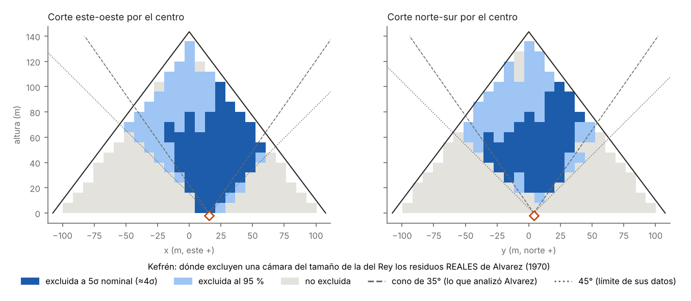

# 20 — Lo que excluyen de verdad los datos de Alvarez

> **Corregido el 01/11/2026 tras una revisión independiente.** La primera versión situaba el detector en (5, −1,5) m. Alvarez escribe (p. 834): *"the equipment is 15.5 meters east and 4 meters north of the center"*, y su ajuste con rayos cósmicos da 13,5 m al este. Además, la regla de que la cámara quepa entera en la pirámide no estaba aplicada en el código, la nula solo reproducía la correlación entre vecinos inmediatos y los mejores "candidatos" quedaban parcialmente fuera de la pirámide. Todo se ha rehecho. La conclusión principal (no hay ninguna cámara) no cambia; las cifras sí.

> **Resumen.** Para cada posición de una posible cámara dentro de Kefrén, predecimos su huella en las 801 casillas de la figura 10 de Alvarez y la comparamos con los residuos publicados. Solo cuentan las posiciones en que la cámara cabe entera: 3 633 de 4 409 para una cámara del tamaño de la del Rey.
> - **Al 95 % de confianza**, los datos excluyen una cámara del tamaño de la del Rey en el **25 %** de esas posiciones; **a 5σ nominal, en el 11 %**. Con la correlación de los residuos, ese umbral equivale a ~4σ.
> - **Dentro del cono de 35°** que analizó Alvarez, la excluyen en el **92 %** al 95 %, pero solo en el **47 %** a 5σ nominal. Su afirmación ("en cualquier punto del cono") se sostiene para ~92 % del cono con el criterio habitual de exclusión, no con el de descubrimiento.
> - **Fuera de ese cono**, sus datos excluyen además un **~7 %** del volumen (el 9 % del volumen exterior al cono). Nadie lo había reclamado.
> - **El mejor "candidato"** está en (−8, −8, 28) m, con Δχ² = −11,9: 3,45σ local nominal y 2,35σ calibrado con la nula. Su significación global es **p = 0,61**: en mapas de puro azar con la misma estructura, el mínimo típico (−12,9) es *más* extremo que el observado. Con los residuos desplazados una fila, el mínimo está en el mismo sitio, con Δχ² = −16,6, pero sigue sin ser significativo: **p global = 0,20 (0,84σ)**. **No hay ninguna cámara en los datos de Alvarez.**
> - **La pista de Gutowski et al. (2017)**, una cámara del tamaño de la del Rey a ~30° del cenit, **queda excluida al 95 % por los propios datos de Alvarez** a todas las alturas de 20 a 60 m, con las cuatro lecturas posibles del acimut. A 70 m queda excluida con tres de las cuatro.

Archivos:
- código: [`simulador/exclusion_alvarez.py`](../simulador/exclusion_alvarez.py), [`simulador/significacion_global_alvarez.py`](../simulador/significacion_global_alvarez.py), [`simulador/figuras_exclusion_alvarez.py`](../simulador/figuras_exclusion_alvarez.py);
- resultados: [`resultados/24_exclusion_alvarez.json`](../resultados/24_exclusion_alvarez.json) (y `.npz`), [`resultados/24b_significacion_alvarez.json`](../resultados/24b_significacion_alvarez.json), [`resultados/24b_significacion_alvarez_fila-1.json`](../resultados/24b_significacion_alvarez_fila-1.json);
- figura: `figuras/11_exclusion_datos_alvarez.png`.

## 1. Método
1. **Detector:** en (15,5; 4; −0,5) m respecto al centro de la base (Alvarez et al. 1970, p. 834).
2. **Rejilla fina uniforme en ángulo** (0,25°), agrupada en las casillas de 3° × 3° de Alvarez.
3. **Aceptancia:** se anula a ~45° en dirección este-oeste. La forma norte-sur se ajusta para esta posición a las predicciones publicadas por Alvarez (figura 9).
4. **Normalización:** ~1600 muones en una casilla central, como dice el artículo. Con esto, el total en las casillas válidas sale ~531 000 (Alvarez seleccionó ~650 000).
5. **Huella de la cámara:** s = (N_con − N_sin)/√N_sin en cada casilla.
6. **Estadístico:** Δχ² = [Σ(r − s)² − Σr²]/κ, con κ = Σr²/801 = 1,34. Δχ² ≥ 3,84 excluye al 95 % de confianza; Δχ² ≥ 25 es "5σ nominal".
   - Los residuos están correlacionados en el espacio, así que Var(r·s) es ~1,5 veces κΣs². Por eso el umbral de 25 equivale en realidad a ~4σ.
   - El criterio del 95 % es conservador y no se ve afectado.
7. **Denominador común:** solo cuentan las posiciones en que la cámara cabe entera, tanto en el código como en el JSON.
8. **Significación global:** se generan 4 000 mapas nulos con la correlación de corto y largo alcance, la dispersión y la media observadas tras redondear (doc. 19), y se repite el mismo barrido de posiciones. Se da la significación con convención de una cola.

## 2. Resultados (rejilla de 8 m)
| Hueco | Excluido al 95 % | Excluido a 5σ nominal | Dentro del cono, al 95 % / a 5σ | Fuera del cono, al 95 % (fracción del total) |
|---|---|---|---|---|
| Del tamaño de la Cámara del Rey | **25 %** | 11 % | 92 % / 47 % | **7,0 %** |
| Cubo de 8 m | 33 % | 24 % | 99 % / 81 % | 10 % |

**Robustez.** Hay cuatro casos: el nominal, los residuos desplazados una fila arriba o abajo, y el detector en (13,5; 4) m. Para la cámara tipo Rey dan entre el 24,5 % y el 25,5 % excluido al 95 %, entre el 11 % y el 12 % a 5σ, del 92 % al 93 % dentro del cono, y del 6,5 % al 7,0 % fuera de él.

### El mejor "candidato"
| Caso | Posición del mínimo (x, y, z) | Δχ² | p global | σ global (una cola) |
|---|---|---|---|---|
| Nominal | (−8, −8, 28) m | −11,9 | **0,61** | < 0 |
| Residuos una fila al norte | (−8, −8, 28) m | −16,6 | **0,20** | 0,84 |
| Residuos una fila al sur | (0, 0, 12) m | −13,6 | — | — |
| Detector en (13,5; 4) m | (−16, −8, 36) m | −11,2 | — | — |
| Cubo de 8 m, nominal | (−32, −16, 68) m | −13,7 | 0,28 | 0,57 |

El candidato es típico de lo que produce un mapa de residuos con la estructura de los de Alvarez.

### La pista de Gutowski et al.
Para una cámara del tamaño de la del Rey a 30° del cenit y acimut 62–72°, con los residuos reales:

| Lectura del acimut | Δχ² a 20 m | a 40 m | a 60 m | a 70 m |
|---|---|---|---|---|
| Desde el norte hacia el este | 489–582 | 83–144 | 23–73 | (no cabe) |
| Desde el este hacia el norte | 240–251 | 44–66 | 14–32 | 11–23 |
| Desde el norte hacia el oeste | 234–250 | 45–60 | 17–26 | 11–19 |
| Desde el este hacia el sur | 254–330 | 35–52 | 8–12 | 0,1–11 |

Todas las casillas con Δχ² ≥ 3,84 están excluidas al 95 %. Los datos de Alvarez descartan esa cámara en todos los casos salvo, parcialmente, a 70 m con la última lectura.

## 3. Qué cambia respecto a los documentos 18 y 19
- **El 19 % de Alvarez es una estimación razonable con criterio de exclusión.** Con sus datos reales se excluye al 95 % en torno a una cuarta parte del volumen. Con criterio de descubrimiento baja al ~11 %, en línea con la lectura pesimista del documento 18.
- **Hay exploración nueva sin medir nada:** un ~7 % adicional del volumen, fuera del cono.
- **Los residuos estructurados producen "candidatos" de 3,5–4σ local de forma rutinaria.** Cualquier análisis futuro, incluido el de ScIDEP desde la misma cámara, debe calibrar su significación global con nulas que conserven la correlación espacial.

## 4. Límites
- **El modelo de aceptancia es aproximado** y coincide con la figura 9 de Alvarez dentro de un ~25 % en los bordes. En la franja de 35–45° esto afecta a la sensibilidad.
- **No se rehace el ajuste de Alvarez.** Su ajuste tenía parámetros libres, como una variación norte-sur de sensibilidad, que podrían haber absorbido parte de la huella de una cámara grande y difusa. La exclusión es más fiable para cámaras compactas.
- **Los residuos están redondeados a σ enteras.**
- **La rejilla es de 8 m**, y las fracciones tienen un error de ~±1–2 puntos.

## Referencias
- Alvarez, L. W. et al. (1970). *Search for hidden chambers in the pyramids*. Science 167, 832–839 (p. 834: posición del equipo; figuras 8–10, p. 836).
- Gutowski, B. et al. (2017). *The secret chambers in the Chephren Pyramid*. arXiv:1712.08590.
- Gamal, M., Aly, S., Kouzes, R. et al. (2025). *The ScIDEP muon radiography project at the Egyptian Pyramid of Khafre*. arXiv:2503.21959.
