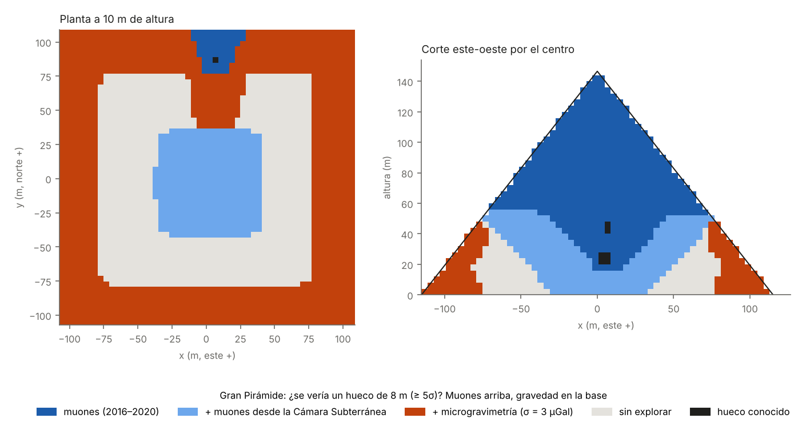

# 21 — Otra sonda: la gravedad ve lo que los muones no ven

> **Resumen.** Los muones llegan desde arriba, así que ven bien la mitad superior de la Gran Pirámide y casi nada de su base (doc. 17). Un hueco, en cambio, es un **déficit de masa**: uno de 8 m equivale a ~1 100 toneladas menos, y su efecto en la gravedad se mide desde cualquier dirección. Calculamos con la fórmula exacta del prisma, verificada contra integración numérica, qué huecos detectaría un estudio de **microgravimetría** desde puntos accesibles: el suelo alrededor de la base, los escalones de las caras hasta 20 m, los corredores interiores y la Cámara Subterránea. Después lo combinamos con el mapa de muones.
>
> Para un hueco cúbico de 8 m, con 3 µGal de ruido por estación:
> - **Gravedad sola: 30 % del volumen**, y el **52 % de los 20 m inferiores**. Los muones publicados cubren el 2 % de esa franja.
> - **Muones actuales + gravedad: 60 %.**
> - **Muones actuales + Cámara Subterránea + gravedad: 79 %.** En la base (0–20 m), del 2 % al 63 %; de 20 a 40 m, del 16 % al 75 %.
> - Con un ruido pesimista de 6 µGal, el total es del 70 %. Para huecos de 5 m, la combinación llega al ~40 %.
>
> Las estaciones más útiles son las de **los escalones de las caras entre 5 y 20 m de altura**: solas cubren el 26 % del volumen. Queda sin cubrir un **anillo a 40–75 m del eje en los 40 m inferiores**, demasiado lejos de las caras para la gravedad y demasiado inclinado para los muones desde la Cámara Subterránea.

Archivos:
- código: [`simulador/piramide/gravimetria.py`](../simulador/piramide/gravimetria.py), [`simulador/estudio_gravimetria.py`](../simulador/estudio_gravimetria.py), [`simulador/figuras_gravimetria.py`](../simulador/figuras_gravimetria.py);
- resultados: [`resultados/25_gravimetria.json`](../resultados/25_gravimetria.json) y `.npz`;
- figura: `figuras/12_muones_y_gravedad.png`.

## 1. Lo que ya se hizo
- **2022: Pašteka, Zahorec, Papčo, Mrlina, Götze y Schmidt** (*J. Archaeol. Sci. Reports* 43, 103464) estudiaron con modelos 3D si una microgravimetría de alta precisión **en las caras de la pirámide** podría cartografiar el Gran Vacío. Concluyeron que en condiciones ideales se pueden resolver efectos de ~1 × 10⁻⁷ m/s² (10 µGal), lo que bastaría para detectarlo. **La idea de medir gravedad sobre las caras de la Gran Pirámide no es nuestra.** Lo que añade este documento es un mapa de cobertura de la base para huecos genéricos y su combinación con la cobertura de los muones.
- **2023:** una evaluación sencilla de la posibilidad de usar microgravímetros para buscar huecos dentro de Keops (*Glob. J. Archaeol. Anthropol.*; también en Research Square).
- **1986: microgravimetría francesa** dentro de la Gran Pirámide. Concluyó que "no hay grandes cámaras ocultas". La operación terminó con perforaciones fallidas en la zona que se creía anómala (Bui, *Imaging the Cheops Pyramid*, Springer 2012). No hemos encontrado publicadas la cobertura y la sensibilidad de aquel estudio. Su desenlace es una advertencia: con la gravedad, una anomalía puede ser un hueco o simplemente relleno menos denso.
- **2016–2023: radar, ultrasonidos y resistividad eléctrica** (ScanPyramids y TUM) junto al corredor de la cara norte. Penetran unos pocos metros, así que sirven para la piel de la pirámide, no para el interior.

## 2. Método
- **Señal.** Componente vertical de la gravedad de un prisma de aire en caliza de 2,2 t/m³, con la fórmula de Nagy (1966). **Comprobación:** coincide con la integración numérica directa en siete configuraciones, con la estación debajo, encima, al lado y cerca del hueco (ver tests). En la primera versión había un error de rama en el arcotangente cuando la estación estaba por encima del hueco, y lo corregimos.
- **Estaciones**, 948 en total:
  - anillo exterior a ras de suelo cada 5 m (188);
  - escalones de las cuatro caras a 5, 10, 15 y 20 m de altura, cada 5 m (664);
  - corredor descendente hasta la Cámara Subterránea (33);
  - Cámara Subterránea (12);
  - túnel de al-Mamún (12);
  - corredor y Cámara de la Reina (17);
  - Gran Galería (16);
  - Cámara del Rey (6).
- **Ruido por estación.** 3 µGal (nominal) o 6 µGal (pesimista). Incluye el instrumento (~1–2 µGal con gravímetros modernos), la heterogeneidad de los bloques y los errores del modelo de masas de la propia pirámide.
- **Tendencias.** En cada grupo de estaciones se elimina la mejor tendencia lineal. Así un gradiente de densidad a gran escala no se confunde con un hueco, aunque también se pierde parte de la señal de los huecos grandes.
- **Criterio.** Significación combinada ≥ 5σ, igual que en el mapa de muones. Se usa la misma rejilla de 4 m que en el documento 17.

## 3. Resultados (hueco de 8 m, ≥ 5σ)
| | σ = 3 µGal | σ = 6 µGal |
|---|---|---|
| Gravedad sola | 30 % | 20 % |
| Muones publicados (2016–2020) | 34 % | 34 % |
| Muones + gravedad | 60 % | 52 % |
| Muones + Cámara Subterránea (1 m² × 100 d) | 53 % | 53 % |
| **Todo** | **79 %** | **70 %** |

### Por alturas (σ = 3 µGal)
| Altura | Muones hoy | Gravedad | Todo |
|---|---|---|---|
| 0–20 m | 2 % | 52 % | **63 %** |
| 20–40 m | 16 % | 38 % | **75 %** |
| 40–60 m | 52 % | 10 % | 91 % |
| > 60 m | 95 % | 0 % | 98 % |

### Qué estaciones aportan (cobertura de cada grupo por separado, σ = 3 µGal)
| Grupo | Volumen cubierto |
|---|---|
| **Escalones de las caras (5–20 m)** | **26 %** |
| Anillo exterior | 5 % |
| Corredor descendente | 2 % |
| Gran Galería, corredor de la Reina, túnel de al-Mamún, Cámara del Rey | ≤ 2 % cada uno |
| Cámara Subterránea | 0 % |

Para huecos de 5 m, la gravedad sola cubre el 13 % (8 % con 6 µGal), y la combinación total llega al 41 % (37 %).

## 4. Un plan de exploración completo para la Gran Pirámide
1. **Muones desde la Cámara Subterránea** (P12): el núcleo, de 6 a 58 m de altura.
2. **Microgravimetría en los escalones de las caras**, de 5 a 20 m de altura, cada 5 m (P14): la banda exterior de la base. Unas 660 estaciones son unos pocos días de trabajo por cara con un gravímetro moderno.
3. **Radar y ultrasonidos** para los primeros metros bajo la superficie, como ya hizo ScanPyramids en la cara norte.
4. **Lo que quedaría sin explorar**, para huecos de 8 m: un anillo a 40–75 m del eje en los 40 m inferiores, ~21 % del volumen. Para cubrirlo harían falta telescopios exteriores de muones de gran área (como los que propone EGP) o una red de gravedad más densa y precisa.

**Una advertencia que viene de 1986:** la gravedad no distingue un hueco de un relleno menos denso. Cualquier anomalía gravimétrica debería confirmarse con muones desde otro ángulo antes de perforar. Las dos técnicas son complementarias también en esto.

## 5. Límites
- **El ruido por estación es una suposición.** No tenemos medidas de la heterogeneidad real de los bloques. En particular, el núcleo de piedra más tosca y los rellenos podrían producir anomalías de varios µGal correlacionadas a escala de decenas de metros. El resultado con 6 µGal da una idea de la sensibilidad a esto.
- **El modelo de masas de la pirámide** (su forma actual, las estructuras conocidas, la roca bajo la base) tendría que ser muy preciso para sustraerlo. La eliminación de la tendencia lineal es una aproximación.
- **Acceso:** medir en los escalones requiere permiso del Ministerio de Turismo y Antigüedades de Egipto, como lo tuvieron ScanPyramids y otros estudios.
- **Huecos de otras formas:** un corredor estrecho y largo da menos señal gravimétrica que un cubo del mismo volumen visto de lado.

## Referencias
- Pašteka, R., Zahorec, P., Papčo, J., Mrlina, J., Götze, H.-J., Schmidt, S. (2022). *The discovery of the "muons-chamber" in the Great pyramid; could high-precision microgravimetry also map the chamber?* J. Archaeol. Sci. Reports 43, 103464.
- Bui, H. D. (2012). *Imaging the Cheops Pyramid*. Springer (microgravimetría de 1986).
- Nagy, D. (1966). *The gravitational attraction of a right rectangular prism*. Geophysics 31, 362–371.
- Grosse, C. et al. (2021–2023). Ensayos no destructivos (radar, ultrasonidos y resistividad eléctrica) en la Gran Pirámide, TUM / ScanPyramids.
