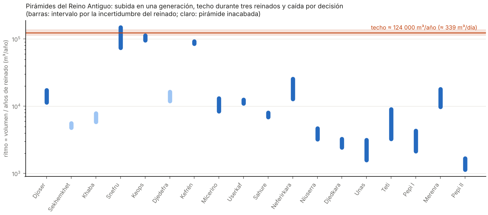

# 23 — ¿Siguieron las pirámides una "ley de aprendizaje"? Un techo, no una curva

> **Pregunta.** En la industria moderna se cumple la **ley de Wright** (1936): cada vez que se duplica la producción acumulada, el coste por unidad baja un porcentaje fijo. Si la construcción de pirámides la hubiera seguido, el ritmo de obra (m³ por año) debería crecer de forma sostenida con la experiencia acumulada. No hemos encontrado ningún estudio que lo haya comprobado con todas las pirámides del Reino Antiguo.
>
> **Respuesta.**
> - **No hay ley de Wright.** En la comparación de modelos de la fase de crecimiento (Djoser → Kefrén), una ley de potencias no es nunca la mejor opción en 20 000 simulaciones Monte Carlo sobre la duración de los reinados.
> - **Hay un techo.** En **una sola generación**, Snefru multiplicó el ritmo de Djoser por 4–13. Después, **tres reinados seguidos** (Snefru, Keops y Kefrén) se mantienen en **85 000–150 000 m³ al año**. La asíntota del ajuste está en **~124 000 m³/año (111 000–139 000), unos 340 m³ al día**. Coincide con las estimaciones independientes del ritmo de Keops (310–345 m³/día).
> - **La caída posterior no es pérdida de conocimiento.** Desde Micerino el ritmo cae entre 6 y 90 veces, justo cuando la experiencia acumulada es máxima. Un saber colectivo de ese tamaño no se olvida en una generación: lo que cambia es la **decisión** de qué hacer con los recursos. En la dinastía V esos recursos fueron, entre otras cosas, a templos solares y complejos funerarios.
>
> **Respuesta cuantitativa a la pregunta de docs/02** ("¿por qué se perdió esa tecnología?"): **no se perdió. Se alcanzó el límite de capacidad del Estado en una generación, se sostuvo durante unos 75 años y después se redirigió.**

Archivos: [`simulador/ley_aprendizaje.py`](../simulador/ley_aprendizaje.py), [`resultados/28_ley_aprendizaje.json`](../resultados/28_ley_aprendizaje.json), `figuras/13_ritmo_de_construccion.png`.

## Datos
- **Volúmenes:** lista de pirámides egipcias (Wikipedia, basada en Lehner 1997 y Verner 2001). Para Snefru se suman sus tres pirámides: Meidum, Acodada y Roja.
- **Duración de los reinados:** intervalos de las cronologías habituales (Canon de Turín, recuentos de ganado, Manetón), por ejemplo Snefru 24–48 años, Keops 23–27, Kefrén 24–26 y Micerino 18–28. Son aproximados y algunos muy inciertos.
- **Ritmo:** R = V/T. Es una **cota inferior** del ritmo real, porque la obra pudo durar menos que el reinado.
- **Experiencia acumulada:** volumen construido antes más la mitad del propio.

## Modelos (fase de crecimiento: Djoser, Snefru, Keops, Kefrén)
| Modelo | Mejor según AICc (fracción de simulaciones) |
|---|---|
| Wright (log R lineal en log C) | **0 %** |
| Techo (aprendizaje que se satura) | 65 % |
| Ritmo constante | 35 % |

Si se fuerza la ley de Wright, el exponente sale b ≈ 0,53, una "tasa de aprendizaje" del 31 % por duplicación. Pero lo produce solo el salto de Djoser a Snefru, y no describe la meseta.

## Límites, que son importantes
- **Solo hay 4 puntos en la fase de crecimiento.** El "techo" gana al "ritmo constante" en el 65 % de las simulaciones: es sugerente, no concluyente. Esto no es una ley nueva, sino una regularidad empírica.
- **El ritmo por reinado mezcla productividad y tamaño de la plantilla.** Sin saber cuánta gente trabajó en cada reinado, no se puede separar "aprendieron a hacerlo mejor" de "pusieron más gente". La ley de Wright se refiere al coste por unidad, y aquí solo tenemos el ritmo total.
- **Solo cuenta el volumen de las pirámides.** Quedan fuera los templos, las calzadas, las mastabas de la corte y los templos solares de la dinastía V.
- **La duración de los reinados es lo más incierto,** sobre todo la de Snefru (24–48 años).

## Qué haría falta para convertirlo en algo más
1. **Datos de plantilla**, a partir de los poblados de trabajadores de Giza, las cuentas de grano y el diario de Merer (papiros de Wadi el-Jarf), para separar productividad de escala.
2. **Ritmos dentro de un mismo reinado**, a partir de las marcas de obra fechadas en los bloques (como las de la pirámide Roja y Meidum), para ver si hubo aprendizaje en la obra.
