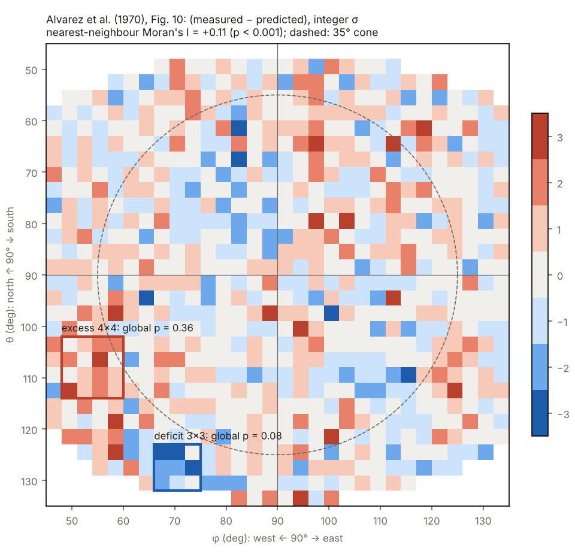
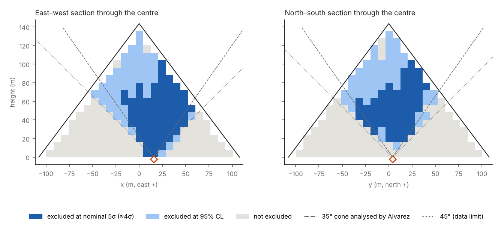

## Abstract

In 1969 L. W. Alvarez and collaborators searched for hidden chambers in Khafre's (Chephren's) pyramid with spark chambers in the Belzoni Chamber. They concluded that no chamber of the size of Khufu's King's Chamber exists within a 35° cone around the vertical, "19 percent" of the pyramid's volume. Besides their conclusion, they published the bin-by-bin map of differences between measured and best-fit predicted muon counts (their Fig. 10; χ² = 905 for an effective ≈750 bins). To our knowledge, this two-dimensional residual map has not been reanalysed. A previous comparison used an azimuthal profile of the same data [5].

We transcribe it (801 bins of 3° × 3°) and find:

1. **The residuals are spatially correlated.** The nearest-neighbour Moran's I is +0.11 (p < 5 × 10⁻⁴ under permutation), and correlations of 0.09–0.14 persist to 2–3 bins. Alvarez's excess χ² reflects structured systematics rather than random noise.
2. **No residual cluster is significant** under a null model that reproduces this short- and long-range correlation. The individual cluster statistics have global p = 0.07–0.83, and all six searches combined give p = 0.19.
3. **A data-driven exclusion map.** We use a simplified forward model with Alvarez's own detector position, normalised to his published predictions. Among positions where the cavity fits inside the pyramid, a King's-Chamber-sized cavity is excluded at **95 % CL in ≈25 %** and at nominal 5σ in ≈11 % (≈4σ once the residual correlation is accounted for). This includes **≈7 % of the volume outside the 35° cone** he analysed. Inside the cone, the exclusion at 95 % CL covers ≈92 %.
4. **The best-fitting "candidate" cavity is not significant.** Its local significance is 3.45σ nominal and 2.35σ when calibrated on the correlated null. Globally it is unremarkable: p = 0.61, or p = 0.20 with the residual map shifted by one row.
5. **The cavity suggested in [5]** (King's-Chamber size at ≈30° zenith) is excluded at 95 % CL by Alvarez's own residuals at all heights from 20 to 60 m above the chamber.

These results bear on the planned ScIDEP measurements from the same chamber [4]. They show that spatially correlated systematics routinely produce 3.5–4σ local "cavities", so global significances must be calibrated with correlated null models.

## 1. Introduction

Alvarez et al. [1] pioneered absorption muography of monuments.

- **Detector:** two 1.8 m × 1.8 m spark chambers with scintillation counters and 1.2 m of iron, in the south-east part of the Belzoni Chamber, the burial chamber cut into the bedrock beneath Khafre's pyramid. According to the paper (p. 834), "the equipment is 15.5 meters east and 4 meters north of the center" of the pyramid; their own cosmic-ray fit placed it at 13.5 m east.
- **Data:** over a million muons in several months, of which ≈650 000 passed the final selection.
- **Conclusion:** comparing with a simulated pyramid, they could "say with confidence that no chambers with volumes similar to the four known chambers in Cheops's and Sneferu's pyramids exist" in the 35° cone.
- **Unfinished plan:** they also announced plans to look through "the remaining 81 percent", which, as far as we know, were never published.

Two developments make a reanalysis timely:

- Muography of the Giza pyramids has since found the Big Void [2] and the North Face Corridor [3] in Khufu's pyramid.
- The ScIDEP collaboration is preparing new scintillator telescopes for the same chamber and outside Khafre's pyramid [4].

Gutowski et al. [5] compared a simple model with Alvarez's data in the 20°–40° zenith band. They reported a possible excess at 62°–72° azimuth and a peak near 270°.

## 2. Data

Alvarez et al. (p. 836) print three 30 × 30 matrices in bins of 3° × 3° in the projected angles θ (north–south) and φ (west–east):

- **Fig. 8:** measured counts;
- **Fig. 9:** predicted counts for the best fit;
- **Fig. 10:** their difference in integer standard deviations.

The caption of Fig. 10 gives χ² = 905, and the text an effective number of bins "close to 750".

**Transcription.** We transcribed Fig. 10 visually from the scanned article at 420–900 dpi, because the OCR layer confuses "1" with "3.". The file is `datos/alvarez_1970/fig10_residuos.txt`.

- **Size and alignment.** The matrix has 801 filled bins in 29 rows. Columns are fixed by the drawn north–south axis; empty bins occur only at the edges. Rows are fixed by the drawn θ = 90° line, which implies that the first row of the matrix is empty, consistent with the zero first rows of Figs. 8 and 9. We nevertheless treat a ±1-row shift as a systematic.
- **Uncertain values.** Three values have an uncertain sign. All 8 sign combinations were analysed; no conclusion changes.
- **Check against χ².** We obtain Σr² = 1074. Rounding a field of the published variance (905/801) would give ≈973. The ≈10 % difference is consistent with edge bins shown in the figure but excluded from the published χ², and/or isolated transcription errors. An independent spot check of 21 rows found no errors.

## 3. Spatial structure of the residuals

**Method.**

- **Spatial correlation:** Moran's I for horizontal and vertical neighbours.
- **Cluster search:** the maximum of Σr/√n over all complete windows of 2×2, 3×3 and 4×4 bins, separately for excesses (more muons: a cavity) and deficits (more matter).
- **Two null models:**
  - (i) 2000 permutations of the residuals among the valid bins;
  - (ii) 4000 Gaussian random fields with two components: 14 % of the variance smoothed with a σ = 1.5-bin kernel, the rest independent. These are rescaled so that, after rounding, they have the observed dispersion and mean, and they reproduce the measured correlations at lags of 1–3 bins (0.09–0.14 observed, 0.04–0.12 simulated).
- **Global p-values:** we compare the observed maximum with the maxima of each simulated map. The combined p-value compares the smallest of the six p-values with its null distribution.

| Statistic | Value | p (permutation) | p (correlated null) | Location (θ, φ) |
|---|---|---|---|---|
| Moran's I | +0.11 | < 5 × 10⁻⁴ | — | — |
| Excess 2×2 | 4.0 | 0.44 | 0.83 | (63°, 96°) |
| Excess 3×3 | 4.7 | 0.05 | 0.55 | (110°, 53°) |
| Excess 4×4 | 5.3 | 0.005 | 0.36 | (108°, 54°) |
| Deficit 2×2 | 5.0 | 0.004 | 0.07 | (126°, 69°) |
| Deficit 3×3 | 5.3 | 0.0005 | 0.08 | (128°, 71°) |
| Deficit 4×4 | 5.0 | 0.002 | 0.25 | (126°, 72°) |
| All six combined | | | **0.19** | |

The residuals are not independent. Under the permutation null, the clusters would look highly significant (p = 0.0005–0.005). Under the correlated null, none is.

## 4. What the data exclude

**Forward model.**

- **Geometry:** Khafre's pyramid (side 215.25 m, original height 143.5 m, present height 136.4 m), limestone 2.2 t/m³. Detector at (15.5, 4, −0.5) m relative to the centre of the base (Alvarez's position); variant at (13.5, 4, −0.5) m.
- **Physics:** Reyna sea-level spectrum and continuous energy loss.
- **Binning:** a fine grid uniform in angle (0.25°), grouped into Alvarez's 3° bins.
- **Acceptance:** vanishes at ≈45° east–west and, fitted to the edge rows of his Fig. 9, at ≈43° north–south.
- **Normalisation:** 1600 counts in a central bin ("in a typical 3- by 3-degree bin there are 1600 events"). The model then predicts ≈531 000 counts in the 801 bins, against ≈650 000 selected events.

**Test statistic.** For a cavity at position v, the footprint in each bin is s = (N_with − N_without)/√N_without, and

  Δχ²_v = [Σ (r − s)² − Σ r²] / κ, with κ = Σr²/801 = 1.34.

A cavity is excluded at 95 % CL if Δχ² ≥ 3.84; we also quote Δχ² ≥ 25 as "nominal 5σ".

Because the residuals are correlated, Var(r·s) is ≈1.5 κΣs². The nominal 5σ threshold therefore corresponds to ≈4σ, while the 95 % CL criterion remains conservative.

Only positions where the cavity fits entirely inside the pyramid are used, in both numerators and denominators: 3633 of 4409 grid points (8 m spacing) for a King's-Chamber-sized cavity.

| Cavity | Excluded, 95 % CL | Excluded, nominal 5σ | Inside 35° cone (95 % / 5σ) | Outside cone, 95 % (share of all fitting positions) |
|---|---|---|---|---|
| King's-Chamber size (10.5 × 5.2 × 5.8 m) | **25 %** | 11 % | 92 % / 47 % | **7.0 %** |
| 8 m cube | 33 % | 24 % | 99 % / 81 % | 10 % |

**Robustness.** We ran the nominal case plus three variants: residual alignment shifted by ±1 row, and the detector at 13.5 m east. For the King's-Chamber-sized cavity they give:

- 24.5–25.5 % excluded at 95 % CL;
- 11–12 % at nominal 5σ;
- 92–93 % of the cone at 95 % CL;
- 6.5–7.0 % outside the cone.

Alvarez's statement for the cone holds for ≈92 % of it at 95 % CL, but not at a discovery threshold.

### The best "candidate"

| Case | Minimum position (x, y, z) | Δχ² | global p | global σ (one-sided) |
|---|---|---|---|---|
| Nominal | (−8, −8, 28) m | −11.9 | **0.61** | < 0 |
| Residuals shifted one row north | (−8, −8, 28) m | −16.6 | **0.20** | 0.84 |
| Residuals shifted one row south | (0, 0, 12) m | −13.6 | — | — |
| Detector at 13.5 m east | (−16, −8, 36) m | −11.2 | — | — |
| 8 m cube, nominal | (−32, −16, 68) m | −13.7 | 0.28 | 0.57 |

**Global p-values.** We apply the same position scan to 4000 correlated null maps. For the nominal case, the median of the null minima is −12.9, more extreme than the observed −11.9.

**Local significance.** The nominal minimum's local significance, calibrated on the null distribution at that position, is 2.35σ (2.59σ for the shifted alignment).

### The cavity suggested in [5]

We place a King's-Chamber-sized cavity at 30° zenith and azimuth 62°–72°, under four possible azimuth conventions. Its Δχ² against Alvarez's residuals is:

- 8–580 at 20–60 m above the chamber: excluded at 95 % CL in every convention;
- 11–23 at 70 m for three conventions;
- 0.1–11 at 70 m for the fourth.

## 5. Cross-check with the raw counts (Figs. 8 and 9)

We also transcribed Alvarez's measured (Fig. 8) and predicted (Fig. 9) counts, verifying all 1800 cells visually (`datos/alvarez_1970/fig8_medidos.csv`, `fig9_predichos.csv`).

- **Consistency with Fig. 10:** they reproduce it in 799 of 801 bins.
- **Totals:** the measured counts sum to 649 034, the "650,000" of the paper.
- **Recomputed χ²:** the Pearson χ² of Alvarez's fit is 983 (published: 905).

**A fully independent refit fails.** Replacing his prediction by our pyramid model, multiplied by a smooth acceptance polynomial, gives χ² = 5 000–11 000 for ≈790 degrees of freedom. His detector had inactive strips between spark-chamber halves and segmented counters, which produce sharp instrumental structure that no smooth correction reproduces. Without a reconstruction of the 1969 instrument, his prediction is needed as a template.

**Poisson reanalysis with his template.**

- **Fit:** N_pred = N_Fig9 · exp(degree-2 polynomial in θ, φ), by Poisson maximum likelihood. It gives χ² = 958 for 795 degrees of freedom, and the residuals correlate at 0.99 with his.
- **Cavity footprint:** applied as our model's relative flux change, with the polynomial profiled out.
- **Global significance:** from correlated nulls calibrated on these residuals.

Results:

- **King's-Chamber-sized cavity:** excluded in 26 % of the fitting positions at 95 % CL and 14 % at nominal 5σ; 95 % / 57 % of the cone; 7.3 % of the volume outside the cone at 95 % CL.
- **8 m cube:** 34 % / 27 %.
- **Best candidate:** Δχ² = −10.8 at (24, −16, 92) m, global p = 0.44.

These agree with Section 4. The exclusion map depends neither on the integer rounding of Fig. 10 nor on the treatment of its dispersion.

## 6. Discussion

- **For Khafre's pyramid.** Alvarez's published residuals contain no evidence of a hidden chamber, consistent with his conclusion. At 95 % CL they exclude a King's-Chamber-sized cavity in about a quarter of the volume where such a cavity would fit, a little more than the 19 % he claimed. At a discovery threshold the excluded fraction drops to about a tenth.
- **For new measurements.** Correlated residuals of the kind found here make 3.5–4σ local "cavities" common. Searches such as ScIDEP's [4] should calibrate global significances with nulls that preserve spatial correlation at several lags.
- **For the method.** Published residual maps from the 1960s–70s can still yield quantitative constraints when combined with a modern forward model and appropriate nulls.

## 7. Limitations

- **Forward model:** simplified, without Geant4. The acceptance and normalisation agree with Alvarez's Fig. 9 only approximately (≈25 % at the edges), which matters most in the 35°–45° band.
- **Alvarez's fit:** we use his prediction as the template (Section 5). An independent refit would require reconstructing his instrument. A large diffuse cavity could have been partly absorbed by his fit; the exclusion is most reliable for compact cavities.
- **Rounding:** the residuals are rounded to integer σ.
- **Null model:** stationary and Gaussian. It reproduces the measured correlations only approximately.

## Data and code

Everything is open at https://github.com/decalion89/pir-mides-:

- `datos/alvarez_1970/fig10_residuos.txt`
- `simulador/reanalisis_alvarez.py`
- `simulador/exclusion_alvarez.py`
- `simulador/significacion_global_alvarez.py`
- `datos/alvarez_1970/fig8_medidos.csv`, `datos/alvarez_1970/fig9_predichos.csv`
- `simulador/reajuste_alvarez.py`
- results in `resultados/23_*.json`, `resultados/24_*.json`, `resultados/24b_*.json` and `resultados/34_*.json`

## References

1. L. W. Alvarez et al., "Search for hidden chambers in the pyramids", *Science* 167, 832–839 (1970).
2. K. Morishima et al., "Discovery of a big void in Khufu's Pyramid by observation of cosmic-ray muons", *Nature* 552, 386–390 (2017).
3. S. Procureur, K. Morishima et al., "Precise characterization of a corridor-shaped structure in Khufu's Pyramid by observation of cosmic-ray muons", *Nat. Commun.* 14, 1144 (2023).
4. M. Gamal, S. Aly, R. Kouzes et al., "The ScIDEP muon radiography project at the Egyptian Pyramid of Khafre", arXiv:2503.21959 (2025).
5. B. Gutowski et al., "The secret chambers in the Chephren Pyramid", arXiv:1712.08590 (2017).
