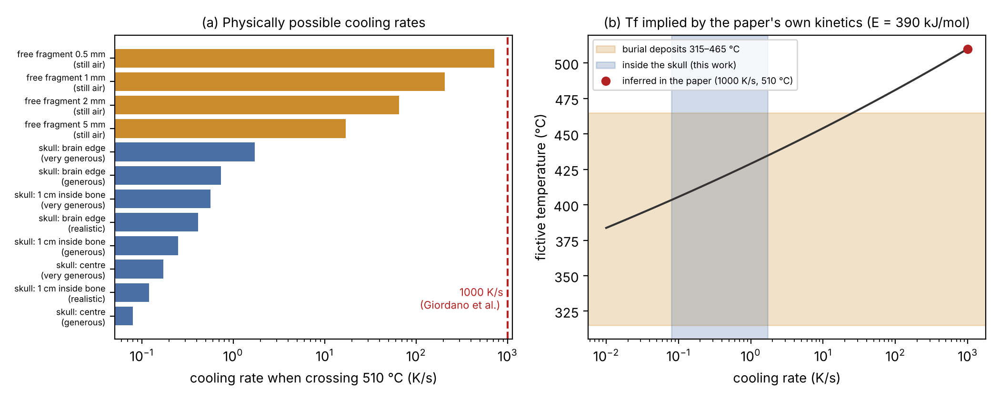

# Heat transfer rules out the proposed thermal history of the vitrified brain from Herculaneum

*Comment on Giordano, G. et al. "Unique formation of organic glass from a human brain in the Vesuvius eruption of 79 CE", Sci. Rep. 15, 5955 (2025).*

[AUTHOR NAME], [AFFILIATION] — labix7@gmail.com

## Abstract
Giordano et al. report DSC onsets of 420 °C (0.42 K s⁻¹) and 510 °C (1000 K s⁻¹) for glassy fragments from the skull of a victim at Herculaneum. From these they infer three things:
- a natural fictive temperature of ≈510 °C;
- cooling "at rates comparable with our experimental 1000 K s⁻¹" after a minutes-long dilute ash cloud passed;
- that this is "the only possible scenario".

We test that thermal history against heat transfer, using the authors' own kinetic parameters (E ≈ 390 kJ mol⁻¹). We find four problems:
1. Material inside a skull cools at 0.1–2 K s⁻¹, not 1000 K s⁻¹. Even free 0.5–5 mm fragments in still air reach only 17–720 K s⁻¹.
2. At physically possible rates, the authors' kinetics give T_f ≈ 405–440 °C. This lies inside the 315–465 °C range of the burial deposits, which is the criterion the authors used to reject 420 °C.
3. Drying and heating the brain above 510 °C needs 3–40 min of full exposure to a 550–750 °C cloud, even before conduction limits are counted.
4. With E = 390 kJ mol⁻¹, the material would soften within ~0.4 s at 465 °C and ~13 h at 350 °C. Any high T_f would anneal in minutes to hours at 315–350 °C.

The calorimetric data may be correct, but the inferred cooling rate and scenario are not supported by heat transfer.

## 0. Prior work
Morton-Hayward et al. (2020) argued qualitatively, in reply to the first report (Petrone et al. 2020), that the Herculaneum pyroclastic flows were neither hot enough nor fast-cooling enough to vitrify brain tissue. Giordano et al. (2025) answer this with a new scenario: an earlier, hotter ash cloud followed by fast cooling. Here we test that specific scenario quantitatively.

## 1. The inference being tested
The two onsets, 420 °C at 0.42 K s⁻¹ and 510 °C at 1000 K s⁻¹, define E/R through ln q = const − (E/R)/T. That is how the authors obtain 390.1 kJ mol⁻¹. Because the onsets shift with heating rate, they describe the material's glass transition *at each heating rate*. They do not measure the natural cooling rate. Equating the natural T_f with the 1000 K s⁻¹ onset rests on an assumed "balanced thermal history", that is, a cooling rate equal to the heating rate.

The authors justify ~1000 K s⁻¹ by citing cooling of tephra falling through air (their ref. 50, Thomas & Sparks 1992). The fragments, however, were "sampled intact, directly from within the skull".

## 2. Cooling rate of the cranial contents
We solved transient radial conduction in a sphere: a 7 cm radius brain plus 6.5 mm of bone, initially uniform at 560 °C. This is deliberately favourable to fast cooling, since it assumes the whole head was heated through. The outer surface loses heat by convection (h = 10–100 W m⁻² K⁻¹) and radiation (ε = 0.9) to 40 °C surroundings, following the paper's "temperature immediately returned to ambient conditions". Effective conductivities are 0.2–1.0 W m⁻¹ K⁻¹ and ρc ≈ 2 MJ m⁻³ K⁻¹.

When each point crosses 510 °C, the cooling rate is:
- 0.4–1.7 K s⁻¹ at the brain margin;
- 0.12–0.57 K s⁻¹ at 1 cm depth;
- 0.08–0.17 K s⁻¹ at the centre.

These are 600–10,000 times below 1000 K s⁻¹ (Fig. 1a).

As an upper bound we also take a fragment *outside* any skull, in still air (Nu = 2) and radiating. It cools at 720, 210, 66 and 17 K s⁻¹ for diameters of 0.5, 1, 2 and 5 mm. Only sub-0.5 mm particles exposed to strong forced convection approach 1000 K s⁻¹.

## 3. Fictive temperature at physically possible rates
Using the paper's own kinetics, T_f = 384, 406, 429, 454, 481 and 510 °C for cooling at 0.01, 0.1, 1, 10, 100 and 1000 K s⁻¹ (Fig. 1b). Cooling at 0.1–2 K s⁻¹ gives T_f ≈ 405–440 °C. The authors reject a natural T_f of 420 °C because it is "comparable or lower than the temperature of the embedding deposits". The same argument then excludes the T_f that heat transfer actually allows.

## 4. Heating in a minutes-long cloud
The brain weighs ~1.35 kg and is 77% water. Warming it, evaporating the water and bringing the dry residue to 510 °C needs ≈3.3 MJ. We assume all the convective and radiative input on 0.06–0.12 m² of head reaches the brain, which ignores the conduction limit through scalp and bone. Even so, a cloud at 550/650/750 °C needs 6–39, 4–29 and 3–22 min, depending on emissivity (0.3–1) and h (30–100 W m⁻² K⁻¹). This is at best marginal for a cloud lasting "on order of minutes".

## 5. Survival during burial
With the paper's E, the equilibrium relaxation time τ ≈ (RT²/E)/q at the measured onset extrapolates to:

| Temperature | τ |
|---|---|
| 465 °C | 0.4 s |
| 400 °C | 3 min |
| 350 °C | 13.5 h |
| 315 °C | 50 days |

The Herculaneum deposits stayed hot for days or longer. Preserving a glassy solid therefore requires the cranial environment to stay below ~330–350 °C. At those temperatures, a glass with T_f = 510 °C anneals in ~0.2–4 min, and one with T_f = 430 °C in ~0.2–2 h (Tool–Narayanaswamy–Moynihan, x = 0.5). The present-day calorimetric signal would record the burial, not the ash cloud.

## 6. What remains, and how to test it
We do not question the glassy character of the material or the DSC data. What heat transfer contradicts is the ~1000 K s⁻¹ cooling and the claim that a short-lived hot cloud followed by fast cooling is the only possible scenario. Two alternatives are compatible with the physics:
- slow pyrolysis of tissue to a glassy carbonaceous solid, at burial temperatures of ~300–350 °C over hours to days;
- conventional cooling at ~0.1–1 K s⁻¹, giving T_f ≈ 405–430 °C.

Both can be tested by measuring the natural T_f directly with the enthalpy area-matching method (Moynihan et al. 1976): a first upscan, then a rescan after controlled cooling at a known rate. Today the natural T_f is assumed rather than measured.

## Data and code
All calculations are in `simulador/herculano_vidrio.py` (results: `resultados/44_herculano_vidrio.json`; figure: `simulador/figuras_herculano.py`) at [REPOSITORY URL].

## References
- Giordano, G. et al. Sci. Rep. 15, 5955 (2025).
- Morton-Hayward, A. L. et al. A conscious rethink: why is brain tissue commonly preserved in the archaeological record? STAR 6, 87–95 (2020).
- Petrone, P. et al. Heat-induced brain vitrification from the Vesuvius eruption in C.E. 79. N. Engl. J. Med. 382, 383–384 (2020).
- Moynihan, C. T., Easteal, A. J., De Bolt, M. A. & Tucker, J. J. Am. Ceram. Soc. 59, 12–16 (1976).
- Thomas, R. M. E. & Sparks, R. S. J. Bull. Volcanol. 54, 542–553 (1992).
- Narayanaswamy, O. S. J. Am. Ceram. Soc. 54, 491–498 (1971).

**Fig. 1.** (a) Cooling rates at 510 °C for points inside a heated skull under realistic to very generous assumptions (blue), and for free fragments in still air (orange). The dashed line is the 1000 K s⁻¹ inferred by Giordano et al. (b) Fictive temperature versus cooling rate from the paper's own kinetics. The blue band is the physically possible rate inside the skull; the orange band is the burial deposit temperatures.
