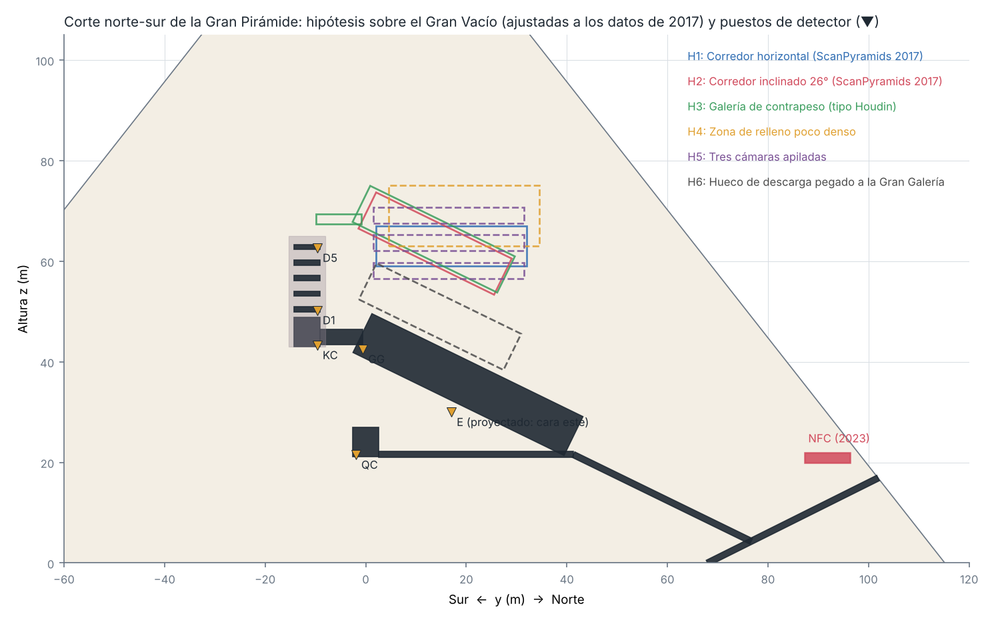
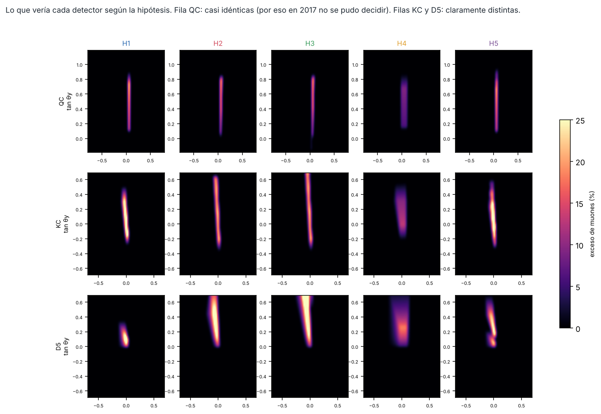
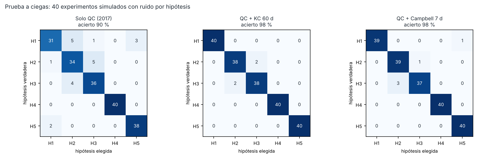
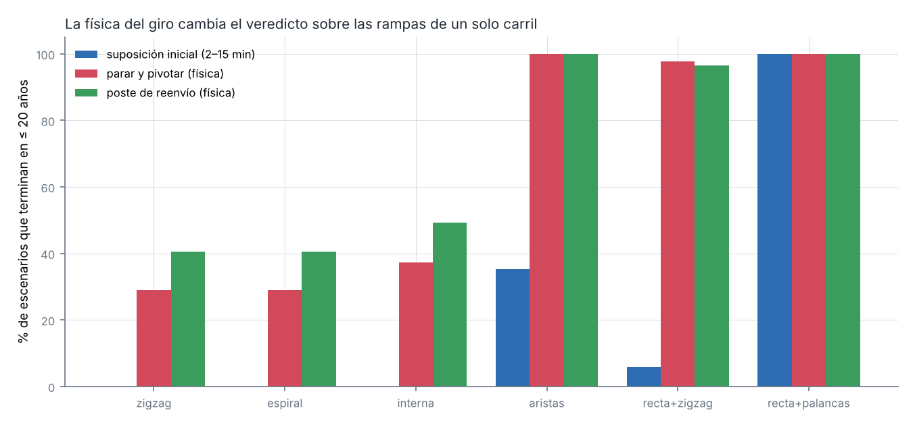

# Abstract

We present an open, reproducible framework that links three questions about the Great Pyramid of Khufu: how its 2.3 million blocks were raised, how the granite roof beams of the King's Chamber were lifted, and what the "Big Void" detected by cosmic-ray muography in 2017 is.

**(i) Forward model and validation.** We build a forward model of muon transmission through the pyramid: the Reyna spectrum, continuous energy loss, and ray tracing through a reconstructed internal geometry. We validate it against the published ScanPyramids results: 5.3 vs 4.4 million emulsion tracks; a void excess of 8.6 % vs 5.2–11 %; significances correct to within a factor ~2.

**(ii) Reanalysis of the published data.** We digitize the published data — 679 KEK hodoscope points and the Nagoya emulsion profiles — and reanalyse them. Calibrating only on the simulated Grand Gallery, our geometry recovers the published emulsion positions to within 0.2 m. The void lies on the Grand Gallery axis (±0.3 m) at ~60–65 m height, with a cross-section of ~10–13 m². Its **inclination cannot be determined robustly from the public data**: the emulsions favour horizontal or shallow geometries, KEK favours inclined ones, and no tested shape (straight, two-segment, two-level) reconciles them (Δχ² ≈ 78). This points to a systematic, not a geometric, cause.

**(iii) A decisive measurement.** Using a joint fit with profiled normalization, gradient and spectral systematics, 225 shape/position variants per hypothesis and blind tests with deliberately altered physics, we show the following. From the Queen's Chamber, five candidate geometries are nearly degenerate: about 2σ. A ~1 m² detector in the **King's Chamber**, a publicly accessible room, separates them, identifying the true hypothesis in 96–98.5 % of blind trials after 60 days; **Campbell's Chamber** does so in about one week.

**(iv) Ramp construction.** In a flow model of ramp construction, the corner-turn time of loaded sledges controls feasibility (rank correlation 0.97). Deriving it from mechanics gives 0.8–2.8 min for stop-and-pivot, or 0.3 min with a rope-redirecting corner post (as suggested by the post holes of the Khufu-era Hatnub ramp), the latter at the cost of 1.4–1.9× larger crews. With these values a single cornered ramp is **possible but tight** (median 20–23 years), while parallel systems leave ample margin.

We report two errors in our own earlier analyses — an extraction artefact that produced a spurious "18° inclination at 4–6σ", and an untested corner-time assumption that had produced "single ramps are impossible" — and how they were caught. All predictions are pre-registered.

# 1. Introduction

ScanPyramids reported a void of length ≥30 m above the Grand Gallery, with a cross-section "comparable to the Grand Gallery" (Morishima et al. 2017). Its orientation — horizontal or inclined — was left open, and so was its function. Proposals range from a structural relieving space to a construction gallery used with counterweights to lift the King's Chamber granite (Houdin).

Separately, the method used to raise the blocks remains debated: external, zigzag, spiral, internal or edge-integrated ramps, and levers. We treat both questions as quantitative problems with falsifiable predictions, and we release all code and data.

# 2. Methods (summary; details in the repository)

**Geometry.** The pyramid is modelled as a convex solid (base 230.33 m, original height 146.6 m; the current truncated shape is used for muography). Chambers and passages are oriented boxes reconstructed from Petrie and from Maragioglio & Rinaldi (±1–2 m).

**Muon model.** We use the Reyna (2006) spectrum (joined to Gaisser above 2 TeV) and E_min(X) = E₀ + (a/b)(e^{bX} − 1) with standard-rock parameters. χ² includes a 2 % per-bin systematic, angular smearing and, in the robustness analysis, profiled normalization, two angular gradients and two spectral terms (proportional to opacity and to cos θ). Directions more than 70° from the zenith are excluded.

**Data digitization.** KEK Extended Data Fig. 4 was read from the PDF vector graphics: each point is four line segments; axes are calibrated with the major ticks. Nagoya Extended Data Fig. 2 is a raster image: data crosses are found as intersections of long horizontal and vertical runs of the series colour. When a bin has two candidates (the data cross and the overlaid fitted curve), the one with the longer vertical error bar is kept.

**Construction model.** Layer by layer (210 courses), the daily rate is the minimum of three limits: lane capacity (sledge spacing and corner occupancy), placement area, and labour (Little's law over hauling, placement, quarrying, ramp building and lever lifts). Monte Carlo over 22 uncertain parameters. Friction is calibrated on the Djehutihotep painting: μ ≈ 0.06–0.11 for 200–350 N per man.

# 3. Validation against published results

| Quantity | Model | Published |
|---|---|---|
| Emulsion NE1 tracks (98 d, 0.45 m², \|tanθ\|<1) | 5.3 × 10⁶ | 4.4 × 10⁶ |
| Big Void excess from the Queen's Chamber | 8.6 % (smoothed) | 5.2–11 % (KEK slices) |
| Big Void significance, Queen's Chamber | 17σ | 13.7σ (NE1) |
| Big Void significance, outside the north face | 2.8σ | 5.8σ (CEA) |
| Emulsion positions from the simulated Grand Gallery alone | +5.7 / −4.3 m | +5.8 / −4.5 m |

# 4. The 2017 data cannot fix the void's shape

We consider five hypotheses:

- H1: a horizontal corridor;
- H2: a corridor inclined at 26°;
- H3: a 26° counterweight gallery joined to the relieving chambers;
- H4: a loose-fill zone;
- H5: stacked low chambers.

Each is fitted to mimic the Queen's Chamber view. H1, H2, H3 and H5 remain within 2.3–2.8σ of each other. A relieving void hugging the Grand Gallery roof is excluded at 29σ, and an open internal spiral ramp of Houdin's type would have produced a 17–32σ ring that is not seen.

# 5. A decisive, low-cost measurement

The test uses a joint fit (Queen's Chamber + new position), with 225 variants per hypothesis (±3 m, cross-section ×0.75–1.25) and profiled systematics. Blind trials are generated with altered physics — flux ±10 % and spectral index ±0.05, limestone 2.35 g/cm³, known chambers displaced by 1 m. The King's Chamber identifies the true hypothesis in **96–98.5 %** of cases after 60 days (1 m², 25 % effective exposure); Campbell's Chamber reaches 97.5 % in 7 days.

The counterweight interpretation (H3) is the most sensitive to flux mismodelling: with a grossly wrong spectrum, H2 is misread as H3. We therefore pre-register four conditions before H3 may be claimed: ≥5σ against H2, open-sky flux calibration, laser-scan geometry, and a second position.

# 6. Reanalysis of the published 2017 data

The fits are robust in three respects:

- the void lies on the Grand Gallery axis, x = 7.1–7.5 m vs 7.3 m;
- its centre is at ~59–65 m height (emulsions), i.e. 38–44 m above the Queen's Chamber;
- its cross-section is ~10–13 m².

The inclination profile (σ against each angle, errors rescaled by χ²/ndf):

| Data | 0° | 10° | 20° | 26° | 35° |
|---|---|---|---|---|---|
| Emulsions (nominal) | 0.4 | 0.9 | 2.2 | 2.8 | 3.9 |
| Emulsions, without the southern slice | 1.6 | 0.5 | 0.1 | 0.4 | 1.0 |
| KEK alone (detector position free) | 4.3 | 2.5 | 1.0 (18°) | 0.0 | 1.8 |

Under a common geometry the two data sets disagree (Δχ² ≈ 78), and the disagreement is unchanged for straight, two-segment and two-level shapes. This indicates a systematic, most plausibly the KEK normalization to the authors' simulation of known structures or the hodoscope geometry, which only the original maps can resolve.

**Our own error.** A first version reported an 18° inclination at 4–6σ, robust to five variations. A leave-one-slice-out test removed it. We traced it to 26 of 396 bins in which the overlaid fitted curve had been digitized instead of the data cross.

# 7. The corner bottleneck in ramp construction

Rotating a 2.6 t sledge needs ~2.4 kN·m of torque, which six lever-men supply in seconds. The cost of a corner is the crew's stop, re-positioning and restart: 0.8–2.8 min in total. A rope-redirecting post reduces corner occupancy to ~0.3 min, at the cost of a capstan factor e^{μ_c π/2} = 1.4–1.9 on crew size.

| Model | Median years | Share of scenarios finishing in ≤ 27 years |
|---|---|---|
| Single cornered ramp (zigzag, spiral or internal) | 20–23 | 74–85 % |
| Four edge ramps | — | 100 % |
| Straight ramp to 45 m + zigzag | — | 96–100 % |
| Straight ramp to 45 m + levers | — | 96–100 % |

An earlier version of our model assumed corner times of 2–15 min and concluded that single ramps were impossible; we withdraw that conclusion. We propose a 2–3-day experimental-archaeology test with pre-registered thresholds: stop-and-pivot ≤ 2.1 min per corner, or post friction μ_c ≤ 0.4, implies that a single ramp suffices.

# 8. Pre-registered predictions

The full list is in `PREDICCIONES.md`, dated in git. The main ones:

1. From the King's Chamber, the five hypotheses produce distinct signatures, separable in ≤ 2 months with 1 m².
2. The void centre lies within ±0.5 m of the Grand Gallery's vertical plane, at 56–66 m height, with a cross-section of 10–13 m².
3. An open internal spiral ramp does not exist.
4. If edge-integrated ramps were used and back-filled with material ≥5 % lighter, an external detector sees helical bands in ~30–300 days.
5. Corner post sockets should exist if the post technique was used.

# 9. Limitations

- No full transport simulation (Geant4); multiple scattering is represented by a fitted angular smearing.
- Approximate internal geometry.
- The reanalysis uses digitized figures, not raw data.
- The construction model is a mean-flow model, not an agent-based one.

# 10. Conclusion

The public data establish where the Big Void is and how large it is, but not its shape. We identify a cheap, accessible measurement that would decide among the competing hypotheses, and a simple experiment that would decide whether a single ramp sufficed. Both are designed so that their results can prove us wrong.

# References

- Morishima, K. et al. *Nature* 552, 386–390 (2017). arXiv:1711.01576.
- Procureur, S. et al. *Nat. Commun.* 14, 1144 (2023).
- Reyna, D. hep-ph/0604145 (2006).
- Gaisser, T. K. *Cosmic Rays and Particle Physics* (1990).
- Fall, A. et al. *Phys. Rev. Lett.* 112, 175502 (2014).
- Tallet, P. *Les papyrus de la mer Rouge I*, MIFAO 136 (2017).
- Enmarch, R. & Gourdon, Y. Hatnub ramp (IFAO / University of Liverpool, 2018).
- Rosell Roig, V. L. arXiv:2511.06112; *npj Heritage Science* (2026).
- Houdin, J.-P. *Khufu: The Secrets Behind the Building of the Great Pyramid* (2006).
- Lehner, M. *The Complete Pyramids* (1997).
- Petrie, W. M. F. *The Pyramids and Temples of Gizeh* (1883).
