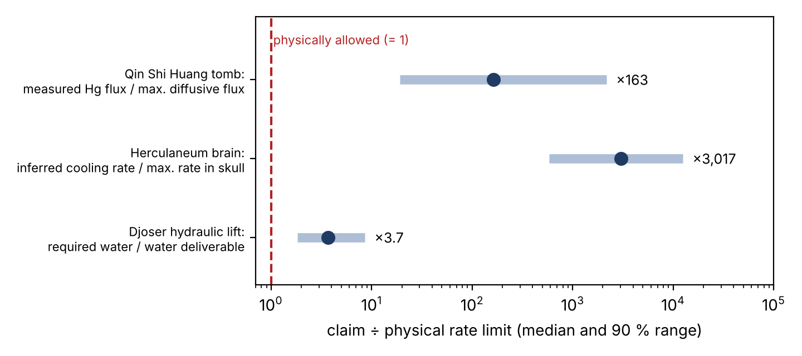

# Abstract
Three recent and widely publicised archaeometric claims reason from a *total*, an *equilibrium* or a *capacity*, while the process they invoke is limited by a *rate*:

- that mercury vapour from the unopened tomb of Qin Shi Huang escapes through the soil (Duan et al. 2020);
- that a Herculaneum victim's brain vitrified on cooling at ~1000 K s⁻¹ (Giordano et al. 2025);
- that the Step Pyramid of Djoser was raised with a flood-fed hydraulic lift (Landreau et al. 2024).

We call this *rate blindness*. In each case we test the claim against the relevant transport limit, using the authors' own numbers and Monte Carlo propagation of uncertainties. The results:

1. **Qin.** The lidar-measured mercury outflux exceeds the maximum diffusive flux from a saturated chamber by a factor of 19–2,170 (median 163). Only advective exchange can supply it: the tomb would have to "breathe" ~460 m³ of saturated air per day.
2. **Herculaneum.** The cooling rate inferred from calorimetry exceeds what heat conduction allows inside a skull by a factor of ~600–12,500. At physically possible rates, the authors' own kinetics give a fictive temperature that overlaps the burial temperatures.
3. **Djoser.** Fed by episodic floods into the proposed reservoirs, the lift receives only 27% (12–55%) of the water the authors themselves compute. The binding constraint is storage between floods, not the total volume.

For each case we give a falsifiable prediction that needs no excavation, or only a sediment core.

# 1. The pattern
Archaeological science often argues from *stocks*: how much mercury is in a tomb, what glass-transition temperature a material shows, how much water a catchment provides. Stocks are easy to estimate and easy to compare. But each mechanism also needs a *flux* to operate on the stated time scale, and every flux has a ceiling:

- diffusion is limited by D·ΔC/L;
- conductive cooling is limited by k/(ρc·L²);
- a reservoir fed by episodic events is limited by storage capacity, overflow and losses.

When the required rate exceeds the ceiling, the conclusion fails however large the stock is. The test is cheap: an order-of-magnitude transport calculation with the paper's own geometry and parameters. In the three cases below it changes the conclusion.

# 2. Qin Shi Huang: a tomb that cannot be sealed
**Claim.** Duan, Zhang & Svanberg (Sci. Rep. 10, 10387, 2020) measured atomic mercury above the mound by differential-absorption lidar. They estimated an outflux of ≈5×10⁻⁸ kg s⁻¹ (uncertain by a factor of ~2) and attributed it to mercury escaping from the burial chamber, "possibly through cracks". The chamber ceiling lies ≈30 m below the surrounding ground, under a ≈50 m mound.

**Test.** Mercury vapour above liquid mercury saturates at C_sat ≈ 9.4 mg m⁻³ at 15 °C. Steady diffusion through L = 30–80 m of compacted loess, with Millington–Quirk diffusivity (porosity 0.30–0.45, water saturation 0.3–0.8) and a source area of 4,000–15,400 m², gives at most 3×10⁻¹⁰ kg s⁻¹ (90% range 3×10⁻¹¹ to 2×10⁻⁹). This bound ignores adsorption, which only lowers the flux further. The measured flux is **163× larger (19–2,170×)**, and none of 2×10⁵ Monte Carlo draws closes the gap. Even a free-air channel spanning the whole roof falls short in 88% of draws. Typical emission from the mound soil (~190 ppb Hg; 10–100 ng m⁻² h⁻¹) also falls short, by a factor of 9–220.

**Implication.** If the lidar flux is right and the source is the tomb, the underground palace must exchange air with the atmosphere at ~460 m³ day⁻¹ (145–1,460). Barometric pumping of the palace volume can supply this. Using the measured 2016 pressure record (Jinghe station, 27 km away), the supply is marginal in summer, mostly through the daily pressure tide, and larger in winter.

**Predictions** (pre-registered in a git-timestamped repository):

- emission rises when barometric pressure falls;
- soil-gas mercury increases with depth;
- winter emission exceeds summer emission;
- a pre-registered night-by-night ranking of the 2016 campaign.

# 3. Herculaneum: a cooling rate heat cannot deliver
**Claim.** Giordano et al. (Sci. Rep. 15, 5955, 2025) measured DSC onsets of 420 °C at 0.42 K s⁻¹ and 510 °C at 1000 K s⁻¹ on glassy fragments (0.5–5 mm) "sampled intact, directly from within the skull". They inferred a natural T_f ≈ 510 °C and cooling "at rates comparable with our experimental 1000 K s⁻¹" once a short-lived ash cloud dissipated. For the rate they cite cooling of tephra falling through air.

**Test.**

- *Cooling.* Transient conduction in a heated head (7 cm brain plus 6.5 mm bone, initially at 560 °C, convective and radiative loss to ambient) gives 0.1–1.7 K s⁻¹ as each point crosses 510 °C. That is **~600–12,500× below** the inferred rate. Even free fragments in still air reach only 17–720 K s⁻¹ (5 to 0.5 mm).
- *Fictive temperature.* At physically possible rates, the paper's own kinetics (E = 390 kJ mol⁻¹) give T_f ≈ 405–440 °C. This overlaps the 315–465 °C burial deposits, the very criterion the authors used to reject 420 °C.
- *Survival.* With the same E, the material would soften within 0.4 s at 465 °C and anneal in minutes to hours at 315–350 °C. The present calorimetric signal would record the burial, not the cloud.
- *Heating.* Drying and heating the brain above 510 °C needs ≥3–40 min of full exposure, which is marginal for a cloud lasting "minutes".

**Prediction.** Measuring the natural T_f with the enthalpy area-matching method, instead of equating it with a heating-rate onset, will give ≈400–440 °C or less.

# 4. Djoser: enough water in total, nowhere to keep it
**Claim.** Landreau et al. (PLOS ONE 19, e0306690, 2024) propose that a float in the 7 × 7 m north shaft raised the stones. Their own figures are:

- water needed: up to 18 Mm³ over 20–30 years;
- supply from the Wadi Taflah: 4–54 Mm³ over the same period, which they judge sufficient for intermediate values;
- storage: the Gisr el-Mudir basin (220,000–440,000 m³, 1–2 m deep) and the Deep Trench (>14,000 m³).

They state that the figures "do not account for water losses caused by infiltration and other factors". Evaporation is not mentioned.

**Test.** We ran a daily water balance over the construction period. Floods arrive as a Poisson process at 0.5–5 per year, with the authors' mean supply. The reservoir loses water to overflow, evaporation (1.5–2.7 m yr⁻¹) and infiltration (0.1–3 m yr⁻¹), and feeds the lift through the Deep Trench. The results:

- the lift receives **27% (12–55%) of the authors' own demand**, and none of 1,500 runs reaches 90%;
- even with zero evaporation and infiltration it receives only 37%;
- about half of every flood overflows the basin, and a full basin dries out in 4–30 months;
- the scheme becomes viable (88–99%) only with three things together: a sealed reservoir of Mm³ scale (for example the whole Dry Moat, 3.5 Mm³, 20 m deep), optimised lift operation, and ≥1–2 floods per year for decades.

**Prediction.** If the lift operated, laminated lacustrine silts dating to the 3rd Dynasty will be found at the base of the Dry Moat or the Deep Trench. Flood gravels or aeolian fill alone would refute the only viable water scenario.

# 5. Discussion
All three papers are careful about their measurements; the gap lies in the step from measurement to mechanism. In each case a rate ceiling, fixed by geometry and textbook transport coefficients, was not checked:

- diffusion through soil (Qin);
- conduction out of a skull (Herculaneum);
- storage between episodic floods (Djoser).

The audits change the conclusions in specific ways:

- the Qin tomb is probably not sealed;
- the Herculaneum glass did not record a 1000 K s⁻¹ quench;
- the Djoser lift needs a reservoir that has not been identified.

Each audit also yields a cheap, decisive test. We suggest that a one-page "rate check" become routine for mechanism claims in archaeometry. The recipe: identify the flux the mechanism requires, compute its physical ceiling with the paper's own geometry, and report the ratio.

**Limitations.**

- Each audit uses simplified geometry and literature ranges for transport properties. The conclusions rest on the size of the mismatches (one to four orders of magnitude for Qin and Herculaneum) rather than on precise values.
- For Djoser the mismatch is a factor of ~2–9 and depends on the palaeoclimate, so we present the result as conditions for viability rather than a refutation.
- The Qin result is conditional on the lidar flux.

# Data and code
All calculations, Monte Carlo inputs and figures are open:

- Qin: `simulador/qin_mercurio.py` and `simulador/qin_presion_prerregistro.py`;
- Herculaneum: `simulador/herculano_vidrio.py`;
- Djoser: `simulador/saqqara_balance_hidrico.py`;
- results: `resultados/42–45_*.json`.

The pre-registered predictions are P15–P16 in `PREDICCIONES.md`.

# References
- Duan, Z., Zhang, W. & Svanberg, S. Mercury as a geophysical tracer gas — emissions from the Emperor Qin tomb in Xi'an studied by laser radar. *Sci. Rep.* 10, 10387 (2020).
- Giordano, G. et al. Unique formation of organic glass from a human brain in the Vesuvius eruption of 79 CE. *Sci. Rep.* 15, 5955 (2025).
- Landreau, X. et al. On the possible use of hydraulic force to assist with building the step pyramid of Saqqara. *PLOS ONE* 19, e0306690 (2024).
- Millington, R. J. & Quirk, J. P. Permeability of porous solids. *Trans. Faraday Soc.* 57, 1200–1207 (1961).
- Moynihan, C. T. et al. Dependence of the fictive temperature of glass on cooling rate. *J. Am. Ceram. Soc.* 59, 12–16 (1976).
- Thomas, R. M. E. & Sparks, R. S. J. Cooling of tephra during fallout from eruption columns. *Bull. Volcanol.* 54, 542–553 (1992).
- NOAA Integrated Surface Database, station 57131 (Jinghe), 2016.
